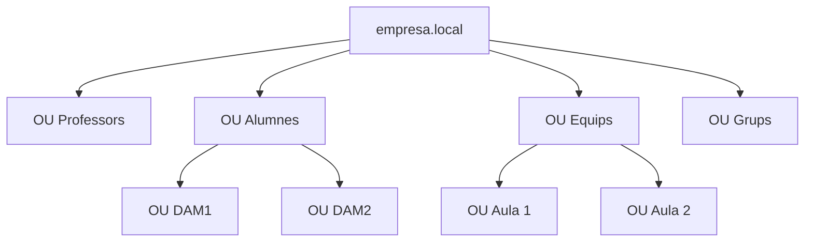
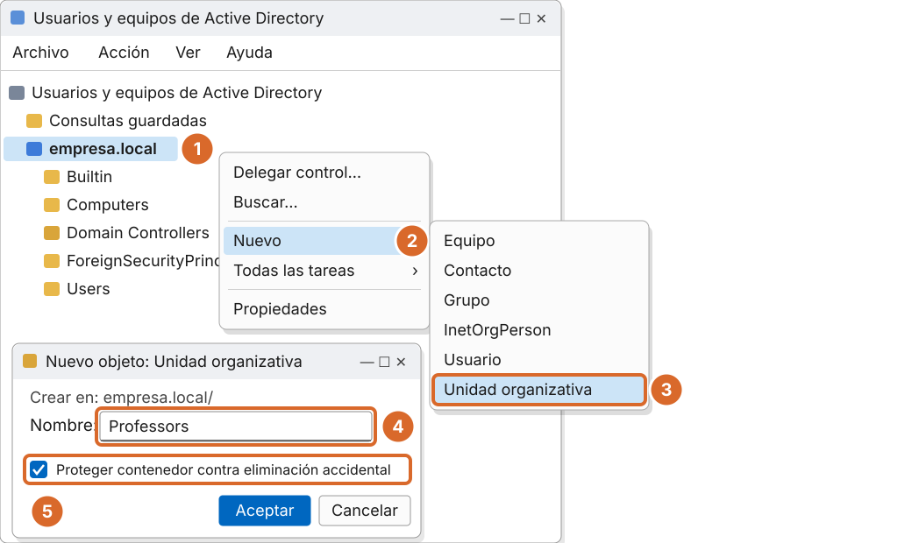
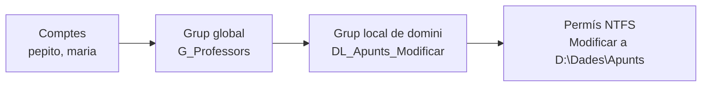
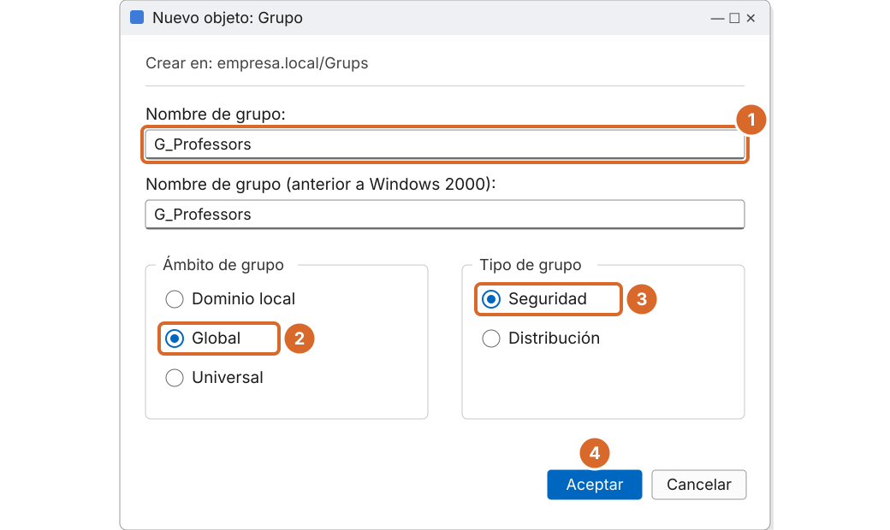

# Tema 1 · Usuaris, grups i unitats organitzatives a Active Directory

> **Mòdul:** Administració de sistemes operatius · 2n DAM
> **Entorn de referència:** Windows Server 2025 (controlador de domini) i clients Windows 11
> **Durada orientativa:** 1 sessió

## Objectius

- Conèixer els objectes principals d'Active Directory: usuaris, grups, equips i unitats organitzatives.
- Diferenciar els tipus i els àmbits de grup.
- Aplicar l'estratègia AGDLP per assignar permisos.
- Crear UO, grups i usuaris des de la consola i amb PowerShell.

---

## 1. Què ha canviat respecte als apunts antics

| Material antic | Ara (curs 2026-27) |
|---|---|
| Windows Server 2003 / 2008 | **Windows Server 2025**, amb el primer nivell funcional nou d'AD des de Windows Server 2016 |
| Consola oberta des d'«Inicio › Programas» | Consoles **ADUC** (`dsa.msc`), **ADAC** (`dsac.exe`), **Windows Admin Center** i sobretot **PowerShell** |
| Clients Windows XP / 7 | Clients **Windows 11** (Windows 10 no té suport des d'octubre de 2025) |
| Tot es feia amb clics, un usuari cada cop | Altes massives amb PowerShell i fitxers CSV |
| Només domini local | **Identitat híbrida**: AD local sincronitzat amb **Microsoft Entra ID** (Entra Connect) |

> Per afegir un controlador de domini Windows Server 2025 a un domini existent, el domini ha de tenir com a mínim el nivell funcional de Windows Server 2016.

---

## 2. Els objectes del directori

| Objecte | Què representa |
|---|---|
| **Usuari** | Una persona (o un servei). Té un nom d'inici de sessió únic al domini i un SID. |
| **Grup** | Conjunt d'usuaris, equips o altres grups per donar permisos i drets a molts alhora. |
| **Equip** | Cada PC o servidor unit al domini té el seu compte d'equip, amb el seu propi SID. |
| **Unitat organitzativa (UO)** | Contenidor per ordenar objectes, delegar l'administració i vincular-hi GPO. |

---

## 3. Unitats organitzatives (UO)

Les UO són **contenidors** d'objectes. Serveixen per:

1. **Ordenar** el directori (no tenir usuaris, grups i equips barrejats).
2. **Delegar** l'administració: per exemple, que el cap d'estudis pugui restablir contrasenyes només de l'UO Alumnes.
3. **Aplicar GPO**: les directives de grup es vinculen a UO, **no a grups**.

Exemple d'estructura per a un institut:



> Pensa l'estructura d'UO segons **com vols aplicar les directives**. Si totes les aules han de tenir el mateix fons d'escriptori, n'hi ha prou amb una UO Equips; si cada aula és diferent, cal una UO per aula.

### Pas a pas: crear una UO



*Recreació esquemàtica de Windows Server 2025. Els números coincideixen amb els passos.*

1. Obre **Usuarios y equipos de Active Directory** (`dsa.msc`) i fes botó dret sobre el domini **empresa.local**.
2. **Nuevo**.
3. **Unidad organizativa**.
4. Escriu el nom: **Professors**.
5. Deixa marcada **Proteger contenedor contra eliminación accidental**.

> Per esborrar una UO protegida: menú **Ver › Características avanzadas**, propietats de la UO, pestanya **Objeto**, desmarca la protecció.

### Amb PowerShell

```powershell
# Crear l'estructura d'UO
New-ADOrganizationalUnit -Name "Professors" -Path "DC=empresa,DC=local"
New-ADOrganizationalUnit -Name "Alumnes"    -Path "DC=empresa,DC=local"
New-ADOrganizationalUnit -Name "DAM2"       -Path "OU=Alumnes,DC=empresa,DC=local"
New-ADOrganizationalUnit -Name "Grups"      -Path "DC=empresa,DC=local"

# Llistar totes les UO
Get-ADOrganizationalUnit -Filter * | Select-Object Name, DistinguishedName

# Treure la protecció i esborrar una UO
Set-ADOrganizationalUnit "OU=DAM2,OU=Alumnes,DC=empresa,DC=local" -ProtectedFromAccidentalDeletion $false
Remove-ADOrganizationalUnit "OU=DAM2,OU=Alumnes,DC=empresa,DC=local" -Recursive
```

---

## 4. Tipus de grup

| | Grups de seguretat | Grups de distribució |
|---|---|---|
| Tenen SID | Sí | No (no serveixen per a seguretat) |
| Poden rebre permisos NTFS, de compartició i drets | Sí | No |
| Poden filtrar GPO | Sí | No |
| Ús | Administrar l'accés als recursos | Llistes de correu (Exchange / Microsoft 365) |

> **Correcció respecte als apunts antics:** els grups de distribució **no** s'utilitzen per instal·lar programari. Avui el desplegament de programari es fa amb GPO, Microsoft Intune o eines com Configuration Manager.

---

## 5. Àmbits de grup

| Àmbit | Pot contenir | S'utilitza per |
|---|---|---|
| **Local de domini** | Usuaris i grups de qualsevol domini del bosc | Donar permisos sobre recursos del seu domini |
| **Global** | Usuaris i grups globals del **mateix** domini | Agrupar persones per funció (departament, curs…) |
| **Universal** | Usuaris i grups de qualsevol domini del bosc | Boscos amb diversos dominis |

Un grup pot ser membre d'un altre grup (**niuament**). El nom del grup ha de ser únic al domini.

---

## 6. L'estratègia AGDLP

**A**ccount → **G**lobal → **D**omain **L**ocal → **P**ermission



- Els **grups globals** representen **persones** (qui són).
- Els **grups locals de domini** representen **permisos** (què poden fer i on).
- **Mai** donem permisos directament a usuaris.

Avantatge: si arriba un professor nou, només cal afegir-lo a `G_Professors` i automàticament té tots els permisos del professorat.

### Pas a pas: crear un grup



*Recreació esquemàtica. Abans: botó dret a l'UO Grups › Nuevo › Grupo.*

1. Nom amb prefix: **G_Professors**.
2. Àmbit: **Global**.
3. Tipus: **Seguridad**.
4. **Aceptar**. Després: **Propiedades › Miembros › Agregar** per afegir-hi usuaris.

### Amb PowerShell

```powershell
# Grup global (persones) i grup local de domini (permís)
New-ADGroup -Name "G_Professors" -GroupScope Global -GroupCategory Security `
  -Path "OU=Grups,DC=empresa,DC=local"
New-ADGroup -Name "DL_Apunts_Modificar" -GroupScope DomainLocal -GroupCategory Security `
  -Path "OU=Grups,DC=empresa,DC=local"

# AGDLP: el grup global dins del local de domini
Add-ADGroupMember -Identity "DL_Apunts_Modificar" -Members "G_Professors"

# Consultar membres (també els niuats)
Get-ADGroupMember "DL_Apunts_Modificar" -Recursive
```

---

## 7. Usuaris

### Crear un usuari amb PowerShell

```powershell
New-ADUser -Name "Pepito Pérez" -GivenName "Pepito" -Surname "Pérez" `
  -SamAccountName "pepito" -UserPrincipalName "pepito@empresa.local" `
  -Path "OU=Professors,DC=empresa,DC=local" `
  -AccountPassword (Read-Host -AsSecureString "Contrasenya") `
  -ChangePasswordAtLogon $true -Enabled $true

Add-ADGroupMember -Identity "G_Professors" -Members "pepito"
```

### Alta massiva des d'un CSV

Fitxer `alumnes.csv`:

```csv
Nom,Cognom,Usuari,Curs
Anna,Puig,apuig,DAM2
Marc,Soler,msoler,DAM2
```

```powershell
$pass = Read-Host -AsSecureString "Contrasenya inicial"
Import-Csv .\alumnes.csv | ForEach-Object {
    New-ADUser -Name "$($_.Nom) $($_.Cognom)" -GivenName $_.Nom -Surname $_.Cognom `
      -SamAccountName $_.Usuari -UserPrincipalName "$($_.Usuari)@empresa.local" `
      -Path "OU=$($_.Curs),OU=Alumnes,DC=empresa,DC=local" `
      -AccountPassword $pass -ChangePasswordAtLogon $true -Enabled $true
    Add-ADGroupMember -Identity "G_$($_.Curs)" -Members $_.Usuari
}
```

### Altres ordres útils

```powershell
Get-ADUser pepito -Properties *                 # totes les propietats
Get-ADUser -Filter * -SearchBase "OU=Alumnes,DC=empresa,DC=local"
Set-ADAccountPassword pepito -Reset             # restablir contrasenya
Unlock-ADAccount pepito                         # desbloquejar
Disable-ADAccount pepito                        # desactivar
Search-ADAccount -AccountInactive -TimeSpan 90.00:00:00 -UsersOnly   # inactius 90 dies
```

Equivalents clàssics de la línia d'ordres (`cmd`):

```cmd
net user pepito /domain
net group "G_Professors" /domain
dsquery user -name "Pepito*"
```

---

## 8. El SID i la Paperera d'AD

Windows no identifica els objectes pel nom, sinó pel **SID** (Security Identifier). Si esborres un grup i el tornes a crear amb el mateix nom, és **un objecte diferent** i perd tots els permisos: els membres no s'esborren, però sí tots els permisos aplicats al grup.

- **Abans:** esborrar era definitiu; calia tornar a assignar usuaris i permisos un per un.
- **Ara:** si s'activa la **Paperera de reciclatge d'AD**, un objecte esborrat es pot restaurar amb el mateix SID i les mateixes pertinences.

```powershell
# Activar la paperera (una sola vegada, és irreversible)
Enable-ADOptionalFeature 'Recycle Bin Feature' -Scope ForestOrConfigurationSet -Target empresa.local

# Veure el SID d'un grup
Get-ADGroup G_Professors | Select-Object Name, SID

# Restaurar un grup esborrat
Get-ADObject -Filter 'Name -like "G_Professors*"' -IncludeDeletedObjects | Restore-ADObject
```

---

## 9. Grups predeterminats importants

| Grup | Què pot fer |
|---|---|
| Admins. del dominio | Control total del domini |
| Administradores de empresas | Control total de tot el bosc |
| Opers. de cuentas | Crear i modificar comptes (excepte administradors) |
| Operadores de copia de seguridad | Fer i restaurar còpies, encara que no tinguin permís sobre els fitxers |
| Opers. de impresión | Administrar les impressores dels controladors de domini |
| Usuarios de escritorio remoto | Iniciar sessió per Escriptori remot |
| Protected Users | Protecció extra de credencials per a comptes sensibles (sense NTLM ni delegació) |

> El grup **Usuarios avanzados (Power Users)** dels apunts antics és heretat: des de Windows Vista no dona privilegis addicionals.

---

## 10. Bones pràctiques

- Nomenclatura clara: **G_** per a grups globals i **DL_** per a locals de domini.
- Permisos sempre a grups, mai a usuaris individuals.
- Compte d'administrador separat del compte de treball diari.
- Activar la Paperera d'AD i mantenir la protecció contra eliminació de les UO.
- Revisar i desactivar els comptes que ja no s'utilitzen.

---

## 11. Pràctica guiada

1. Crea l'estructura d'UO de l'apartat 3 amb PowerShell.
2. Crea els grups `G_Professors`, `G_DAM2` i `DL_Apunts_Modificar` dins l'UO Grups.
3. Dona d'alta 3 alumnes de DAM2 a partir d'un CSV.
4. Aplica AGDLP: `G_Professors` ha de ser membre de `DL_Apunts_Modificar`.
5. Activa la Paperera d'AD, esborra un usuari i restaura'l. Comprova que té el mateix SID.

**Lliurament:** captures de l'estructura a ADUC, l'script de PowerShell i el resultat de `Get-ADGroupMember -Recursive`.

---

## 12. Comprova-ho

1. Quina diferència hi ha entre un grup de seguretat i un de distribució?
2. Per què no és una bona idea donar permisos directament a un usuari?
3. Què passa amb els permisos si esborres un grup i el tornes a crear amb el mateix nom?
4. A què es pot vincular una GPO: a un grup o a una UO?

<details>
<summary>Respostes</summary>

1. El de seguretat té SID i pot rebre permisos; el de distribució només serveix per al correu.
2. Costa de mantenir: cal tocar permisos a cada canvi de persona. Amb grups (AGDLP) només es canvia la pertinença.
3. Es perden, perquè el SID és nou. Només es recuperen restaurant-lo des de la Paperera d'AD.
4. A una UO (o al domini o al lloc). Els grups serveixen per filtrar-la.

</details>

---

## Fonts

- [What's new in Windows Server 2025 – Microsoft Learn](https://learn.microsoft.com/en-us/windows-server/get-started/whats-new-windows-server-2025)
- [Mòdul ActiveDirectory de PowerShell – Microsoft Learn](https://learn.microsoft.com/en-us/powershell/module/activedirectory/)
