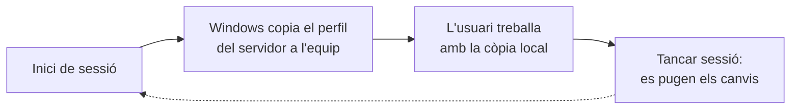
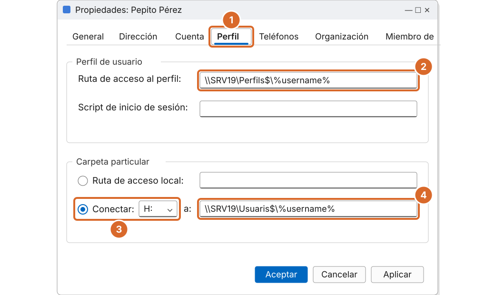
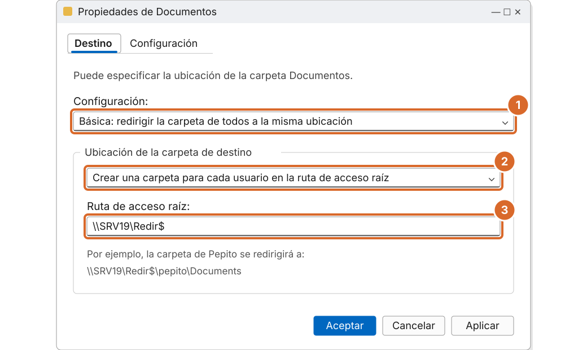

# Tema 2 · Perfils mòbils i redirecció de carpetes

> **Mòdul:** Administració de sistemes operatius · 2n DAM
> **Entorn de referència:** Windows Server 2025 i clients Windows 11
> **Durada orientativa:** 1 sessió

## Objectius

- Distingir els tipus de perfil d'usuari.
- Configurar un perfil mòbil i una carpeta particular.
- Redirigir carpetes amb una GPO.
- Diagnosticar els problemes habituals dels perfils.

---

## 1. Què és un perfil d'usuari

El perfil és el conjunt de carpetes i configuració d'un usuari: escriptori, documents, configuració dels programes i el registre de l'usuari (**NTUSER.DAT**).

- **On es guarda avui:** a `C:\Users\nom_usuari`. La ruta `C:\Documents and Settings` era de Windows XP.
- **Quan es crea:** la primera vegada que l'usuari inicia sessió en un equip, a partir del perfil `C:\Users\Default`.

Avantatges:

- Diversos usuaris poden fer servir el mateix equip, cadascun amb la seva configuració.
- Els canvis d'un usuari no afecten els altres.

```powershell
# Veure els perfils d'un equip
Get-CimInstance Win32_UserProfile | Select-Object LocalPath, RoamingConfigured, Loaded
```

---

## 2. Tipus de perfil

| Tipus | Descripció |
|---|---|
| **Local** | Es crea i es queda a l'equip. Si l'usuari canvia de PC, comença de zero. |
| **Mòbil** | Es guarda en una carpeta compartida del servidor i segueix l'usuari a qualsevol equip del domini. |
| **Obligatori** | Perfil mòbil de només lectura: els canvis es perden en tancar la sessió. El fitxer `NTUSER.DAT` es reanomena `NTUSER.MAN`. |
| **Temporal** | Windows el crea quan no pot carregar el perfil. És un senyal que alguna cosa falla. |

---

## 3. Com funciona un perfil mòbil



> Si l'usuari obre sessió en dos equips alhora, el perfil que es pugi l'últim sobreescriu l'altre. Per això els perfils grans o les sessions simultànies donen problemes.

### Les versions de perfil

Windows afegeix un sufix a la carpeta segons la versió. Amb Windows 10 i 11 veurem `\\SRV19\Perfils$\pepito.V6`.

Un perfil d'una versió no es pot fer servir amb una altra: si l'usuari entra amb sistemes diferents, tindrà una carpeta per a cada versió.

---

## 4. Preparar la carpeta al servidor

1. Crea la carpeta `D:\Perfils` al servidor.
2. Desactiva l'herència i aplica aquests permisos NTFS:

| Qui | Permís NTFS | S'aplica a |
|---|---|---|
| Grup d'usuaris amb perfil mòbil | Mostrar carpeta / leer datos + Crear carpetas / anexar datos | Només aquesta carpeta |
| CREATOR OWNER | Control total | Només subcarpetes i fitxers |
| SYSTEM i Administradors | Control total | Carpeta, subcarpetes i fitxers |

3. Comparteix-la com a **Perfils$** (el `$` l'amaga) amb permís de compartició *Usuarios autentificados: Control total*. La seguretat real la fan els permisos NTFS.

Així cada usuari pot crear la seva carpeta però no pot entrar a la dels altres. Windows crea la carpeta de l'usuari automàticament el primer cop que inicia sessió.

```powershell
# Crear i compartir la carpeta de perfils
New-Item -Path D:\Perfils -ItemType Directory
New-SmbShare -Name 'Perfils$' -Path D:\Perfils -FullAccess "EMPRESA\Usuarios del dominio" `
  -FolderEnumerationMode AccessBased -CachingMode None

# Permisos NTFS amb icacls
icacls D:\Perfils /inheritance:r
icacls D:\Perfils /grant "SYSTEM:(OI)(CI)F" "Administradores:(OI)(CI)F"
icacls D:\Perfils /grant "CREATOR OWNER:(OI)(CI)(IO)F"
icacls D:\Perfils /grant "EMPRESA\G_PerfilMobil:(RD,AD)"
```

> `(RD,AD)` són els permisos especials *Mostrar carpeta/leer datos* i *Crear carpetas/anexar datos*. Sense `(OI)(CI)` s'apliquen només a la carpeta.

---

## 5. Assignar el perfil a l'usuari



*Recreació esquemàtica de Windows Server 2025.*

1. Propietats de l'usuari › pestanya **Perfil**.
2. Ruta del perfil mòbil: `\\SRV19\Perfils$\%username%`.
3. Carpeta particular: **Conectar H:**.
4. Ruta: `\\SRV19\Usuaris$\%username%`.

`%username%` és una variable que Windows substitueix pel nom d'inici de sessió de l'usuari.

Per a molts usuaris alhora: selecciona'ls tots a ADUC i edita les propietats comunes, o fes-ho amb PowerShell:

```powershell
# Un usuari
Set-ADUser pepito -ProfilePath '\\SRV19\Perfils$\%username%' `
  -HomeDrive 'H:' -HomeDirectory '\\SRV19\Usuaris$\pepito'

# Tots els usuaris d'una UO
Get-ADUser -Filter * -SearchBase "OU=Professors,DC=empresa,DC=local" | ForEach-Object {
    Set-ADUser $_ -ProfilePath '\\SRV19\Perfils$\%username%' `
      -HomeDrive 'H:' -HomeDirectory "\\SRV19\Usuaris$\$($_.SamAccountName)"
}
```

> Amb PowerShell la carpeta particular **no** es crea sola (amb ADUC sí). Cal crear-la i donar-hi permisos a l'usuari.

També es pot definir el perfil per **GPO d'equip**: *Configuración del equipo › Directivas › Plantillas administrativas › Sistema › Perfiles de usuario › Establecer ruta de perfil móvil para todos los usuarios que inicien sesión en este equipo*.

### La carpeta particular

A **Carpeta particular › Conectar** assignem una lletra (per exemple `H:`) i la ruta `\\SRV19\Usuaris$\%username%`. Avantatge: ADUC crea la carpeta i hi dona control total a l'usuari automàticament.

---

## 6. Redirecció de carpetes per GPO

La redirecció fa que les carpetes **Documents, Escriptori, Imatges…** visquin directament al servidor. No viatgen dins el perfil, així que:

- el perfil és petit i l'inici de sessió és ràpid;
- les dades queden al servidor, dins les còpies de seguretat.

Ruta a la GPO: *Configuración de usuario › Directivas › Configuración de Windows › Redirección de carpetas › Documentos* (botó dret › Propiedades).



*Recreació esquemàtica de Windows Server 2025.*

1. Configuració: **Básica: redirigir la carpeta de todos a la misma ubicación**.
2. **Crear una carpeta para cada usuario en la ruta de acceso raíz**.
3. Ruta d'accés arrel: `\\SRV19\Redir$`.

> Això substitueix el que deien els apunts antics: anar a *Mis documentos › Propiedades* i canviar la ruta a mà a cada usuari. Amb la GPO es fa per a tota una UO de cop.

```powershell
# Carpeta per a la redirecció
New-Item D:\Redir -ItemType Directory
New-SmbShare -Name 'Redir$' -Path D:\Redir -FullAccess "EMPRESA\Usuarios del dominio"

# Al client, després de gpupdate i de tornar a iniciar sessió:
gpresult /r
[Environment]::GetFolderPath("MyDocuments")   # ha de retornar \\SRV19\Redir$\usuari\Documents
```

---

## 7. Abans i ara

| Material antic | Ara (curs 2026-27) |
|---|---|
| Perfils mòbils sencers amb tots els documents a dins | Perfil mòbil petit + redirecció de carpetes per GPO |
| Canviar la ruta de «Mis documentos» a mà | GPO de redirecció per a tota una UO |
| Clients Windows XP i Windows 7 | Windows 11. Al núvol: **OneDrive** amb *Known Folder Move* i equips units a **Microsoft Entra ID** |
| — | Escriptoris virtuals (Azure Virtual Desktop, RDS): contenidors de perfil **FSLogix** |

---

## 8. Problemes habituals

| Símptoma | Causa probable | Com comprovar-ho |
|---|---|---|
| L'usuari entra amb un perfil temporal | Permisos incorrectes o servidor inaccessible | Visor d'esdeveniments › Aplicación, origen *User Profile Service* |
| L'inici de sessió és molt lent | Perfil massa gran: falta redirecció de carpetes | Mida de la carpeta del perfil al servidor |
| Es perden canvis | Sessió oberta en dos equips alhora | Preguntar a l'usuari / registres d'inici de sessió |
| Apareixen carpetes `.V6` noves | L'usuari ha entrat amb una altra versió de Windows | Carpetes a `Perfils$` |

```powershell
# Esdeveniments del servei de perfils al client
Get-WinEvent -LogName Application -MaxEvents 50 |
  Where-Object ProviderName -eq "Microsoft-Windows-User Profiles Service"
```

---

## 9. Pràctica guiada

1. Crea i comparteix `Perfils$` i `Usuaris$` amb els permisos de l'apartat 4.
2. Assigna perfil mòbil i carpeta particular `H:` als usuaris de l'UO Professors.
3. Inicia sessió amb `pepito` en un client, canvia el fons d'escriptori i tanca la sessió.
4. Inicia sessió en un **altre** client: el fons ha de ser el mateix.
5. Crea una GPO de redirecció de Documents i comprova que els fitxers apareixen a `\\SRV19\Redir$`.
6. Converteix el perfil d'un usuari en obligatori (`NTUSER.MAN`) i comprova que els canvis es perden.

---

## 10. Comprova-ho

1. On es guarda el perfil local d'un usuari a Windows 11?
2. Quina diferència hi ha entre un perfil mòbil i un d'obligatori?
3. Per què es recomana combinar el perfil mòbil amb la redirecció de carpetes?
4. Què significa la variable `%username%` a la ruta del perfil?

<details>
<summary>Respostes</summary>

1. A `C:\Users\nom_usuari`.
2. L'obligatori és de només lectura (`NTUSER.MAN`): els canvis es perden en tancar sessió.
3. Perquè el perfil sigui petit i l'inici de sessió ràpid; les dades queden al servidor.
4. Windows la substitueix pel nom d'inici de sessió de l'usuari.

</details>

---

## Fonts

- [Deploy roaming user profiles – Microsoft Learn](https://learn.microsoft.com/en-us/windows-server/storage/folder-redirection/deploy-roaming-user-profiles)
- [Deploy Folder Redirection – Microsoft Learn](https://learn.microsoft.com/en-us/windows-server/storage/folder-redirection/deploy-folder-redirection)
