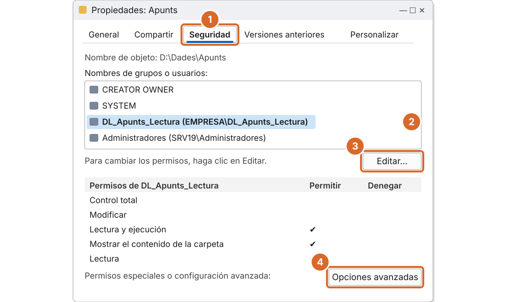
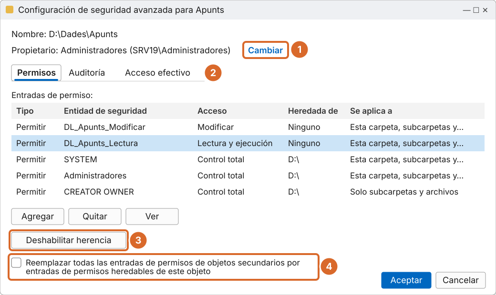
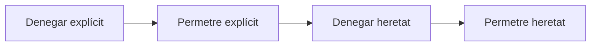

# Tema 3 · Permisos NTFS

> **Mòdul:** Administració de sistemes operatius · 2n DAM
> **Entorn de referència:** Windows Server 2025 i clients Windows 11
> **Durada orientativa:** 1-2 sessions

## Objectius

- Entendre les ACL i les ACE.
- Conèixer els permisos estàndard i especials.
- Controlar l'herència i calcular el permís efectiu.
- Gestionar permisos des de la consola, amb `icacls` i amb PowerShell.

---

## 1. Dues capes de seguretat

| Capa | Quan s'aplica |
|---|---|
| **Permisos NTFS** | Sempre: tant si s'accedeix des del mateix equip com des de la xarxa. |
| **Permisos de compartició** | Només quan s'hi accedeix per la xarxa (SMB). Es veuen al [tema 4](../04-comparticio-smb/README.md). |

Aquest tema tracta la primera capa, la que fa realment la feina. Els volums **ReFS** també fan servir ACL de la mateixa manera.

---

## 2. ACL i ACE

Cada fitxer i carpeta té una **ACL** (llista de control d'accés). Cada línia de la llista és una **ACE**: *qui*, *quin permís* i si es *permet* o es *denega*.

| Qui | Permís | Tipus |
|---|---|---|
| DL_Apunts_Lectura | Lectura i execució | Permetre |
| DL_Apunts_Modificar | Modificar | Permetre |
| Alumnes_Expulsats | Escriptura | Denegar |

Només el **propietari** de l'objecte, o qui tingui el permís *Cambiar permisos*, pot modificar l'ACL.

### Pas a pas: la pestanya Seguridad



*Recreació esquemàtica de Windows Server 2025.*

1. Botó dret sobre la carpeta › **Propiedades › Seguridad**.
2. Selecciona el grup per veure'n els permisos.
3. **Editar...** per afegir grups o canviar permisos.
4. **Opciones avanzadas** per a l'herència, el propietari i els permisos especials.

---

## 3. Permisos estàndard

| Permís | Què permet |
|---|---|
| **Control total** | Tot, inclòs canviar permisos i prendre possessió |
| **Modificar** | Llegir, escriure i esborrar, però **no** canviar permisos ni prendre possessió |
| **Lectura i execució** | Veure el contingut i executar programes |
| **Mostrar contingut de la carpeta** | Com l'anterior, però només per a carpetes |
| **Lectura** | Veure fitxers, atributs i permisos |
| **Escriptura** | Crear fitxers i carpetes i afegir-hi dades |

> **Correcció respecte als apunts antics:** deien que *Modificar* permetia canviar permisos i prendre possessió. És al revés: aquestes dues accions són exclusives de *Control total*.

En els **fitxers** hi ha els mateixos permisos excepte *Mostrar contingut de la carpeta*. Un fitxer agafa per defecte els permisos de la carpeta que el conté.

---

## 4. Permisos especials

Els permisos estàndard són combinacions de 14 permisos especials. Es veuen a **Opciones avanzadas › (selecciona una entrada) › Editar › Mostrar permisos avanzados**.

| Grup | Permisos especials | Lletra a `icacls` |
|---|---|---|
| **Llegir** | Recórrer carpeta / executar fitxer | `X` |
| | Mostrar carpeta / llegir dades | `RD` |
| | Llegir atributs · Llegir atributs estesos | `RA` · `REA` |
| | Permisos de lectura | `RC` |
| **Escriure** | Crear fitxers / escriure dades | `WD` |
| | Crear carpetes / afegir dades | `AD` |
| | Escriure atributs · Escriure atributs estesos | `WA` · `WEA` |
| **Esborrar** | Eliminar subcarpetes i fitxers | `DC` |
| | Eliminar | `DE` |
| **Controlar** | Canviar permisos | `WDAC` |
| | Prendre possessió | `WO` |

El primer nom de cada parella s'aplica a carpetes i el segon a fitxers (per exemple, *Crear fitxers* a una carpeta, *Escriure dades* a un fitxer).

---

## 5. L'herència

- Per defecte, els permisos d'una carpeta passen a les subcarpetes i fitxers.
- Els permisos heretats surten **en gris**: no es poden editar des del fill.
- **Deshabilitar herencia**: Windows pregunta si vols **convertir** els heretats en explícits o **treure'ls**.
- **Reemplazar todas las entradas de permisos de objetos secundarios…** des del pare força l'herència a tots els fills, encara que l'hagin bloquejada.
- Cada ACE es pot limitar amb **Se aplica a**: «només aquesta carpeta», «només subcarpetes i fitxers», etc.

> Recomanació: converteix en explícits i després treu el que sobra. Si els treus directament, la carpeta pot quedar sense cap permís.

### Pas a pas: configuració de seguretat avançada



*Recreació esquemàtica de Windows Server 2025.*

1. **Propietario › Cambiar**: canviar el propietari.
2. **Acceso efectivo**: comprovar el permís real d'un usuari.
3. **Deshabilitar herencia**: trencar l'herència.
4. **Reemplazar…**: forçar l'herència als fills.

---

## 6. Les regles dels permisos NTFS

1. **El que no es permet explícitament, es denega.** Si cap ACE et dona accés, no hi tens accés.
2. **Els permisos se sumen.** Si un grup et dona Lectura i un altre Escriptura, tens les dues coses.
3. **Denegar guanya** sobre un permetre del mateix nivell. Fes-lo servir poc: complica molt trobar errors.
4. **L'explícit guanya a l'heretat.** Un permetre posat directament al fitxer preval sobre un denegar heretat del pare.

Ordre d'avaluació real:



> **Matís que faltava als apunts antics:** «denegar sempre guanya» només és cert al mateix nivell.

**Permisos de fitxer i de carpeta:** si tens permís sobre un fitxer però no sobre la carpeta que el conté, encara pots obrir-lo escrivint-ne la ruta completa. Això passa perquè, per defecte, tots els usuaris tenen el dret *Omitir comprobación de recorrido* (*Bypass traverse checking*).

---

## 7. Exemple: calculem el permís efectiu

Usuari1 és membre de **Grup A** (Lectura a la carpeta) i **Grup B** (Escriptura a la carpeta). A més, Grup A té **denegada l'escriptura** directament al Fitxer2.

| Objecte | Grup A | Grup B | Resultat |
|---|---|---|---|
| Fitxer1 | Lectura (heretada) | Escriptura (heretada) | **Lectura + Escriptura** |
| Fitxer2 | Lectura, escriptura denegada (explícita) | Escriptura (heretada) | **Només lectura** |

A Fitxer2 la denegació és explícita i l'escriptura de Grup B és heretada: guanya la denegació. Per comprovar-ho: *Propiedades › Seguridad › Opciones avanzadas › Acceso efectivo*.

---

## 8. El propietari

- Qui crea un fitxer o carpeta en passa a ser el **propietari**. El propietari sempre pot canviar-ne els permisos.
- Els administradors (o qui tingui el permís *Tomar posesión*) poden fer-se propietaris d'un objecte.
- Des de Windows Vista, un administrador **pot assignar el propietari directament a un altre usuari**.

> **Correcció:** els apunts antics deien que la propietat no es podia transferir. Avui es fa des d'*Opciones avanzadas › Propietario › Cambiar*, o amb `icacls /setowner`.

```cmd
:: Fer-se propietari (administrador) d'una carpeta i tot el que conté
takeown /F D:\Dades\Apunts /R /A
:: Assignar el propietari a un altre usuari
icacls D:\Dades\Apunts /setowner EMPRESA\pepito /T
```

---

## 9. Atributs: no són permisos

| Atributs | Permisos |
|---|---|
| Afecten l'objecte per igual per a tothom | Depenen de qui accedeix |
| Només lectura, ocult, arxiu, comprimit, xifrat (EFS), indexat | Control total, Modificar, Lectura… |

Per protegir un disc sencer avui es fa servir **BitLocker**. EFS xifra fitxers concrets d'un usuari.

```cmd
attrib +R +H D:\Dades\secret.txt     :: només lectura i ocult
compact /C D:\Dades\Arxiu            :: comprimir
cipher /E D:\Dades\Privat            :: xifrar amb EFS
manage-bde -status                   :: estat de BitLocker
```

---

## 10. Permisos des de la línia d'ordres

### icacls

```cmd
:: Veure els permisos
icacls D:\Dades\Apunts

:: Donar Modificar, heretable per carpetes (CI) i fitxers (OI)
icacls D:\Dades\Apunts /grant "EMPRESA\DL_Apunts_Modificar:(OI)(CI)M"

:: Donar Lectura i execució
icacls D:\Dades\Apunts /grant "EMPRESA\DL_Apunts_Lectura:(OI)(CI)RX"

:: Denegar l'escriptura
icacls D:\Dades\Apunts\examen.docx /deny "EMPRESA\G_DAM2:W"

:: Desactivar l'herència copiant els permisos (d) o treient-los (r)
icacls D:\Dades\Apunts /inheritance:d

:: Treure totes les entrades d'un grup
icacls D:\Dades\Apunts /remove "EMPRESA\G_DAM2"

:: Desar i restaurar les ACL d'un arbre
icacls D:\Dades /save C:\acl_dades.txt /T
icacls D:\ /restore C:\acl_dades.txt
```

Lletres: `F` control total, `M` modificar, `RX` lectura i execució, `R` lectura, `W` escriptura. Herència: `(OI)` fitxers, `(CI)` carpetes, `(IO)` només als fills.

### PowerShell

```powershell
# Veure l'ACL
Get-Acl D:\Dades\Apunts | Format-List

# Afegir una ACE
$acl  = Get-Acl D:\Dades\Apunts
$rule = New-Object System.Security.AccessControl.FileSystemAccessRule(
          "EMPRESA\DL_Apunts_Lectura", "ReadAndExecute",
          "ContainerInherit,ObjectInherit", "None", "Allow")
$acl.AddAccessRule($rule)
Set-Acl D:\Dades\Apunts $acl

# Copiar l'ACL d'una carpeta a una altra
Get-Acl D:\Dades\Apunts | Set-Acl D:\Dades\Apunts2
```

---

## 11. Pràctica guiada

1. Crea `D:\Dades\Apunts` amb dues subcarpetes: `Teoria` i `Examens`.
2. `DL_Apunts_Modificar` (amb `G_Professors` a dins) ha de tenir Modificar a tot.
3. `DL_Apunts_Lectura` (amb `G_DAM2`) ha de poder llegir `Teoria` però **no** veure `Examens`.
4. Fes-ho una vegada per la consola i una altra amb `icacls`.
5. Comprova amb **Acceso efectivo** el permís de `pepito` i d'un alumne a cada carpeta.
6. Desa les ACL amb `icacls /save`.

---

## 12. Comprova-ho

1. Quina diferència hi ha entre Modificar i Control total?
2. Un usuari té Lectura per un grup i Escriptura per un altre. Quin permís té?
3. Un permís denegat heretat i un de permès explícit: quin guanya?
4. És el mateix l'atribut «Només lectura» que el permís de Lectura?

<details>
<summary>Respostes</summary>

1. Control total afegeix canviar permisos i prendre possessió.
2. Lectura + Escriptura, perquè els permisos se sumen.
3. El permès explícit.
4. No: l'atribut afecta tothom per igual; el permís depèn de l'usuari o grup.

</details>

---

## Fonts

- [icacls – Microsoft Learn](https://learn.microsoft.com/en-us/windows-server/administration/windows-commands/icacls)
- [How permissions are evaluated – Microsoft Learn](https://learn.microsoft.com/en-us/windows/security/identity-protection/access-control/access-control)
