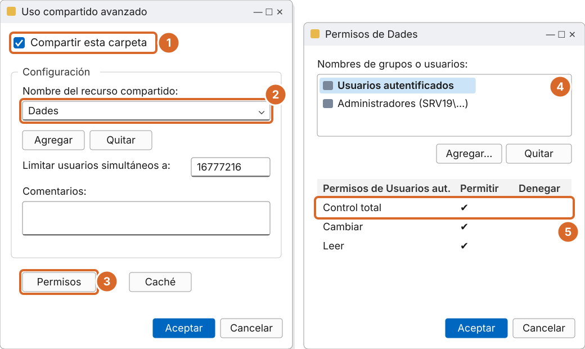
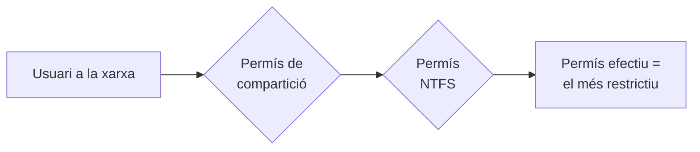

# Tema 4 · Compartir carpetes a la xarxa (SMB)

> **Mòdul:** Administració de sistemes operatius · 2n DAM
> **Entorn de referència:** Windows Server 2025 i clients Windows 11
> **Durada orientativa:** 1 sessió

## Objectius

- Conèixer el protocol SMB i la seva evolució.
- Compartir carpetes i configurar-ne els permisos.
- Combinar els permisos de compartició amb els NTFS.
- Aplicar les novetats de seguretat SMB de Windows 11 24H2 i Windows Server 2025.

---

## 1. El protocol SMB

| | |
|---|---|
| **Què és** | *Server Message Block*: el protocol que fa servir Windows per compartir fitxers i impressores. Port **TCP 445**. |
| **Versió actual** | SMB 3.1.1, amb signatura, xifratge i comprovació d'integritat. Samba fa servir el mateix protocol a Linux. |
| **SMB1, retirat** | Desactivat per defecte. Era la porta d'entrada de WannaCry (2017). No s'ha de tornar a activar. |

> CIFS, que surt als apunts antics, és el nom d'un dialecte antic de SMB1. Avui es parla simplement de SMB.

```powershell
# Versió de SMB que fan servir les connexions actives (al client)
Get-SmbConnection | Select-Object ServerName, ShareName, Dialect

# Comprovar que SMB1 està desactivat (al servidor)
Get-SmbServerConfiguration | Select-Object EnableSMB1Protocol, EnableSMB2Protocol
```

---

## 2. Maneres de compartir una carpeta

| Eina | Ruta |
|---|---|
| **Explorador** | Propiedades › Compartir › Uso compartido avanzado › Compartir esta carpeta |
| **Consola del servidor** | Administrador del servidor › Servicios de archivos y almacenamiento › Recursos compartidos |
| **Administración de equipos** | `compmgmt.msc` › Carpetas compartidas › Recursos compartidos |
| **PowerShell** | `New-SmbShare`: ràpid i repetible, ideal per a molts recursos |

### Pas a pas: compartir una carpeta



*Recreació esquemàtica de Windows Server 2025.*

1. Marca **Compartir esta carpeta**.
2. Nom del recurs: **Dades** (amb `$` al final si ha de ser ocult).
3. Botó **Permisos**.
4. Treu *Todos* i afegeix **Usuarios autentificados**.
5. Dona'ls **Control total**: la seguretat la posarà NTFS.

El botó **Caché** configura els fitxers sense connexió (apartat 7). El límit d'usuaris simultanis per defecte és el màxim permès (16.777.216).

---

## 3. Permisos de compartició

| Permís | Què permet per la xarxa |
|---|---|
| **Leer** | Veure carpetes i fitxers, obrir-los i executar programes |
| **Cambiar** | Leer + crear, modificar i esborrar fitxers i carpetes |
| **Control total** | Cambiar + modificar els permisos NTFS (si NTFS ho permet) |

Només tres nivells, molt menys fins que NTFS.

---

## 4. Com es combinen NTFS i compartició

Accedint **per la xarxa** s'apliquen les dues capes i **guanya la més restrictiva**. Accedint **en local**, només compta NTFS.

| Compartició | NTFS | Per la xarxa | En local |
|---|---|---|---|
| Leer | Modificar | **Leer** | Modificar |
| Control total | Lectura | **Lectura** | Lectura |
| Control total | Modificar | **Modificar** | Modificar |



> **Bona pràctica:** compartició oberta (*Usuarios autentificados: Control total*) i NTFS ajustat. Així només hi ha un lloc on mirar quan algú no pot entrar.

---

## 5. Recursos ocults i administratius

Si el nom acaba en `$`, el recurs no surt a la llista de la xarxa, però s'hi pot accedir escrivint la ruta: `\\SRV19\Perfils$`.

| Recurs | Per a què serveix |
|---|---|
| `C$`, `D$`… | Arrel de cada disc, només per a administradors |
| `ADMIN$` | Carpeta `C:\Windows`, per a l'administració remota |
| `IPC$` | Comunicació entre processos (llistar recursos, RPC) |
| `NETLOGON` i `SYSVOL` | Scripts i GPO del domini (als controladors de domini) |

```cmd
net share                 :: llistar els recursos del servidor
net view \\SRV19 /all     :: veure'ls des d'un client, inclosos els ocults
```

---

## 6. Enumeració basada en l'accés (ABE)

Amb ABE activada, cada usuari només veu les carpetes on té permís. Si no hi pots entrar, ni la veus.

```powershell
Set-SmbShare -Name Dades -FolderEnumerationMode AccessBased
```

També es pot activar a l'Administrador del servidor › Recursos compartidos › Propiedades › Configuración › *Habilitar enumeración basada en el acceso*.

---

## 7. Fitxers sense connexió

- **Què fan:** guarden una còpia dels fitxers del recurs a l'equip client per treballar-hi sense xarxa.
- **Què passa en tornar:** Windows sincronitza els canvis amb el servidor. Si dos usuaris han tocat el mateix fitxer, hi ha un **conflicte** que cal resoldre.
- **On es configura:** propietats del recurs › Uso compartido avanzado › **Caché**, o per GPO.

> **Correcció:** els apunts antics deien que els canvis fets a la memòria cau es perdien. En realitat es sincronitzen quan torna la connexió; el risc són els conflictes.

```powershell
Set-SmbShare -Name Dades -CachingMode None      # sense fitxers sense connexió
Set-SmbShare -Name Dades -CachingMode Manual    # l'usuari tria què vol tenir sense connexió
```

---

## 8. Connectar unitats de xarxa

```cmd
:: Clàssic (cmd)
net use S: \\SRV19\Dades /persistent:yes
net use                        :: veure connexions
net use S: /delete             :: desconnectar
```

```powershell
# PowerShell
New-SmbMapping -LocalPath "S:" -RemotePath "\\SRV19\Dades" -Persistent $true
Get-SmbMapping
Remove-SmbMapping -LocalPath "S:"
```

En un domini es fa amb una GPO: *Configuración de usuario › Preferencias › Configuración de Windows › Unidades asignadas*. Vegeu el [tema 5](../05-directives-gpo/README.md).

---

## 9. Novetats de seguretat SMB (2024-2026)

| Canvi | Detall |
|---|---|
| **Signatura obligatòria** | Windows 11 24H2 exigeix signar totes les connexions SMB (entrants i sortints) a les edicions Pro, Enterprise i Education. Windows Server 2025 l'exigeix a les sortints. |
| **Adeu a l'accés d'invitat** | Windows 11 Pro ja no es connecta a recursos sense usuari ni contrasenya. |
| **Ports NetBIOS fora** | Les regles del tallafoc ja no obren els ports 137-139: SMB modern només fa servir el 445. |
| **Xifratge** | No és obligatori per defecte, però es pot exigir per recurs o al client. |

**Conseqüència a l'aula:** alguns NAS antics o recursos amb accés d'invitat deixen de funcionar amb Windows 11 24H2. La solució correcta és configurar usuaris i signatura al NAS, no desactivar la seguretat del client.

```powershell
# Comprovar si la signatura és obligatòria
Get-SmbClientConfiguration | Select-Object RequireSecuritySignature
Get-SmbServerConfiguration | Select-Object RequireSecuritySignature

# Exigir xifratge en un recurs concret
Set-SmbShare -Name Dades -EncryptData $true
```

---

## 10. Crear un recurs complet amb PowerShell

```powershell
# Carpeta i recurs compartit
New-Item -Path "D:\Dades" -ItemType Directory
New-SmbShare -Name "Dades" -Path "D:\Dades" `
  -FullAccess "EMPRESA\Usuarios del dominio" -FolderEnumerationMode AccessBased

# Permisos de compartició
Get-SmbShareAccess -Name Dades
Grant-SmbShareAccess  -Name Dades -AccountName "Usuarios autentificados" -AccessRight Full -Force
Revoke-SmbShareAccess -Name Dades -AccountName "Todos" -Force

# Qui està connectat i quins fitxers té oberts
Get-SmbSession
Get-SmbOpenFile

# Esborrar el recurs (la carpeta no s'esborra)
Remove-SmbShare -Name Dades -Force
```

---

## 11. Pràctica guiada

1. Crea i comparteix `D:\Dades` com a `Dades` amb *Usuarios autentificados: Control total*.
2. Dins, crea `Professors` i `DAM2` amb permisos NTFS per a cada grup.
3. Activa ABE i comprova des d'un client que un alumne no veu la carpeta `Professors`.
4. Crea un recurs ocult `Arxiu$` i accedeix-hi escrivint la ruta `\\SRV19\Arxiu$`.
5. Comprova amb `Get-SmbConnection` que el client fa servir SMB 3.1.1.

---

## 12. Comprova-ho

1. Compartició: Control total. NTFS: Lectura. Quin permís té l'usuari per la xarxa?
2. Què passa si poses `$` al final del nom d'un recurs?
3. Per què Windows 11 24H2 no es connecta a alguns NAS antics?
4. Quin port fa servir SMB modern?

<details>
<summary>Respostes</summary>

1. Lectura: guanya la capa més restrictiva.
2. El recurs queda ocult a la llista de la xarxa, però s'hi pot accedir amb la ruta.
3. Perquè exigeix signatura SMB i ja no permet l'accés d'invitat.
4. TCP 445.

</details>

---

## Fonts

- [SMB security hardening – Microsoft Learn](https://learn.microsoft.com/en-us/windows-server/storage/file-server/smb-security-hardening)
- [SMB signing – Microsoft Learn](https://learn.microsoft.com/en-us/windows-server/storage/file-server/smb-signing)
- [Accessing a third-party NAS with SMB in Windows 11 24H2 may fail – Microsoft Tech Community](https://techcommunity.microsoft.com/blog/filecab/accessing-a-third-party-nas-with-smb-in-windows-11-24h2-may-fail/4154300)
