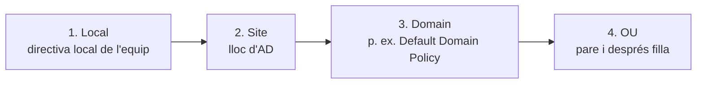
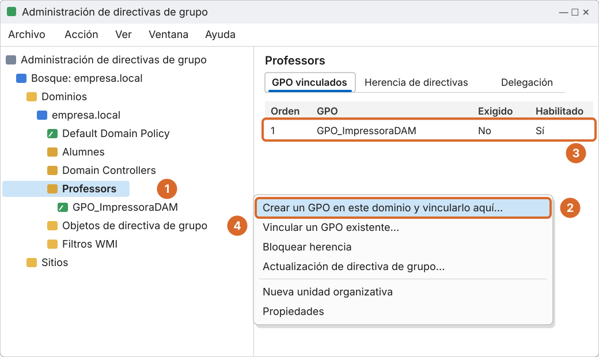
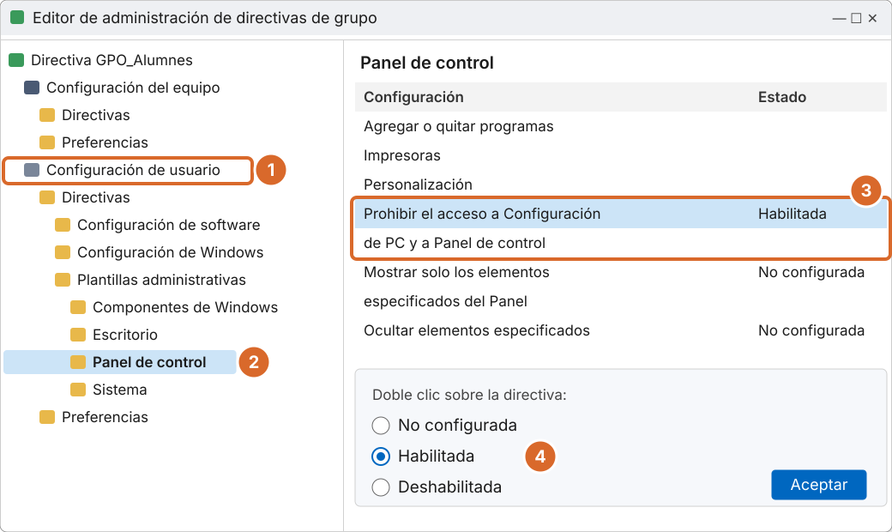

# Tema 5 · Directives de grup (GPO)

> **Mòdul:** Administració de sistemes operatius · 2n DAM
> **Entorn de referència:** Windows Server 2025 i clients Windows 11
> **Durada orientativa:** 1-2 sessions

## Objectius

- Entendre què és una GPO i on es guarda.
- Conèixer l'ordre d'aplicació LSDOU i com es resolen els conflictes.
- Crear, vincular, editar i filtrar GPO.
- Diferenciar directives i preferències.
- Comprovar l'aplicació de les GPO amb `gpupdate` i `gpresult`.

---

## 1. Què és una GPO

Una GPO (*Group Policy Object*) és un conjunt de configuracions que el domini aplica automàticament als usuaris i equips d'una UO, d'un domini o d'un lloc.

| | |
|---|---|
| **On viu** | Una part a Active Directory (*GPC*) i els fitxers a la carpeta compartida **SYSVOL** dels controladors de domini (*GPT*): `\\empresa.local\SYSVOL\empresa.local\Policies\{GUID}` |
| **Amb què s'administra** | Consola **Administración de directivas de grupo** (`gpmc.msc`) i l'editor de cada GPO |

---

## 2. Ordre d'aplicació: LSDOU



Dins de cada nivell, si hi ha diverses GPO vinculades, s'apliquen segons l'**ordre de vincles** (la de número 1 té més prioritat).

> Els apunts antics no parlaven del nivell **Lloc** (*Site*). L'ordre complet és Local, Site, Domain, OU.

### Qui guanya en un conflicte?

**Guanya l'última GPO aplicada, la més propera a l'usuari o equip.** No guanya «la més restrictiva».

> **Correcció important:** els apunts antics deien que s'aplica la més restrictiva. No és així; és l'última que s'aplica en l'ordre LSDOU.

Excepcions:

- **Exigido** (*Enforced*): una GPO forçada no es pot sobreescriure per les de sota. Guanya fins i tot a un bloqueig d'herència.
- **Bloquear herencia**: una UO pot ignorar les GPO dels nivells superiors (excepte les exigides).

---

## 3. Les dues GPO per defecte

| GPO | Vinculada a | Conté |
|---|---|---|
| **Default Domain Policy** | El domini | Directives de compte: contrasenyes, bloqueig de comptes i Kerberos |
| **Default Domain Controllers Policy** | UO *Domain Controllers* | Configuració dels controladors de domini: drets d'usuari, auditoria… |

> **Correcció:** la segona GPO no afecta «controladors de subdomini», sinó tots els controladors de domini del domini.
> **Bona pràctica:** no carregar-les de configuracions. Crea GPO noves per a cada necessitat.

---

## 4. Crear, vincular i esborrar

| Acció | Com es fa | Què passa |
|---|---|---|
| Crear i vincular | Botó dret a la UO › *Crear un GPO en este dominio y vincularlo aquí* | La GPO existeix i s'aplica a la UO |
| Vincular una existent | Botó dret a una altra UO › *Vincular un GPO existente* | Una mateixa GPO serveix per a diverses UO |
| Eliminar el vincle | Botó dret al vincle › *Eliminar* | Deixa d'aplicar-se però es conserva a *Objetos de directiva de grupo* |
| Eliminar la GPO | Des d'*Objetos de directiva de grupo* › *Eliminar* | Desapareix del tot i de tots els vincles |

### Pas a pas: crear i vincular una GPO



*Recreació esquemàtica de Windows Server 2025.*

1. Botó dret sobre l'UO **Professors**.
2. **Crear un GPO en este dominio y vincularlo aquí...** i escriu el nom.
3. El vincle apareix a la pestanya de GPO vinculats.
4. Totes les GPO es guarden a **Objetos de directiva de grupo**.

### Amb PowerShell

```powershell
Import-Module GroupPolicy

# Crear una GPO i vincular-la
New-GPO -Name "GPO_FonsEscriptori" -Comment "Fons d'escriptori de l'institut" |
  New-GPLink -Target "OU=Alumnes,DC=empresa,DC=local"

# Vincular una GPO existent a una altra UO
New-GPLink -Name "GPO_FonsEscriptori" -Target "OU=Professors,DC=empresa,DC=local"

# Forçar (Exigido) i bloquejar l'herència
Set-GPLink -Name "GPO_FonsEscriptori" -Target "OU=Alumnes,DC=empresa,DC=local" -Enforced Yes
Set-GPInheritance -Target "OU=Professors,DC=empresa,DC=local" -IsBlocked Yes

# Veure l'herència d'una UO
Get-GPInheritance -Target "OU=Alumnes,DC=empresa,DC=local"

# Treure el vincle i esborrar la GPO
Remove-GPLink -Name "GPO_FonsEscriptori" -Target "OU=Professors,DC=empresa,DC=local"
Remove-GPO -Name "GPO_FonsEscriptori"
```

---

## 5. Configuració d'equip i d'usuari

| | Configuración del equipo | Configuración de usuario |
|---|---|---|
| **S'aplica a** | L'equip, sigui qui sigui l'usuari | L'usuari, a qualsevol equip |
| **Quan** | En arrencar l'equip | En iniciar sessió |
| **On cal vincular la GPO** | A la UO on hi ha els **equips** | A la UO on hi ha els **usuaris** |

Les GPO es tornen a aplicar cada **90 minuts** aproximadament (amb un marge aleatori de fins a 30). Als controladors de domini, cada 5 minuts.

> Error típic: vincular una GPO amb configuració d'equip a una UO que només té usuaris. No fa res.

### Pas a pas: editar una directiva



*Recreació esquemàtica de Windows Server 2025. Abans: botó dret a la GPO › Editar.*

1. **Configuración de usuario** (s'aplica a l'usuari).
2. Directivas › Plantillas administrativas › **Panel de control**.
3. Busca la directiva a la llista de la dreta.
4. Doble clic › **Habilitada** › Aceptar.

```powershell
# Habilitar la mateixa directiva amb PowerShell (valor de registre)
Set-GPRegistryValue -Name "GPO_Alumnes" `
  -Key "HKCU\Software\Microsoft\Windows\CurrentVersion\Policies\Explorer" `
  -ValueName "NoControlPanel" -Type DWord -Value 1
```

---

## 6. Directives i preferències

| | Directivas | Preferencias |
|---|---|---|
| Com s'apliquen | Forçades: l'usuari no les pot canviar | Valor inicial: l'usuari el pot modificar |
| Si s'elimina la GPO | La configuració es desfà | La configuració normalment es queda |
| Exemples | Contrasenyes, bloquejar el Panell de control, BitLocker | Mapar unitats, impressores, accessos directes, registre |

Les preferències permeten la **segmentació a nivell d'element** (*Destinatarios de nivel de elemento*): per exemple, mapar la unitat `P:` només si l'usuari és membre de `G_Professors`.

Exemple: mapar una unitat de xarxa per preferències

1. *Configuración de usuario › Preferencias › Configuración de Windows › Unidades asignadas*.
2. Botó dret › Nuevo › Unidad asignada.
3. Acción: **Actualizar** · Ubicación: `\\SRV19\Dades` · Letra: `S:`.

---

## 7. Exemples actuals de directives

| Àmbit | Exemples |
|---|---|
| **Seguretat** | Contrasenyes i bloqueig de comptes · **Windows LAPS** (contrasenya d'administrador local única per equip) · BitLocker · tallafoc |
| **Entorn de l'usuari** | Fons d'escriptori i menú Inici · **Microsoft Edge** (amb plantilles ADMX) · redirecció de carpetes ([tema 2](../02-perfils-mobils/README.md)) |
| **Drets d'usuari** | Canviar l'hora · fer còpies de seguretat · denegar l'inici de sessió local o per Escriptori remot |
| **Scripts** | Scripts d'inici de sessió en **PowerShell**. VBScript està en retirada: no se'n han de fer de nous. |
| **Programari** | Instal·lar paquets `.msi` en iniciar sessió o arrencar l'equip |

> **Actualització:** Internet Explorer es va retirar el 2022; ara es configura Microsoft Edge descarregant-ne les plantilles ADMX i copiant-les a `\\empresa.local\SYSVOL\empresa.local\Policies\PolicyDefinitions` (magatzem central). Windows LAPS ve integrat a Windows des del 2023. L'exemple `benvingut.vbs` dels apunts antics s'ha de fer en PowerShell.

Script d'inici de sessió equivalent a `benvingut.vbs`:

```powershell
# benvingut.ps1 (Configuración de usuario › Directivas › Configuración de Windows › Scripts › Inicio de sesión)
Add-Type -AssemblyName PresentationFramework
[System.Windows.MessageBox]::Show("Benvingut/da, $env:USERNAME!", "Institut")
New-SmbMapping -LocalPath "S:" -RemotePath "\\SRV19\Dades" -ErrorAction SilentlyContinue
```

---

## 8. Filtrar a qui s'aplica

| Mecanisme | Què fa |
|---|---|
| **Filtrado de seguridad** | Per defecte s'aplica a *Usuarios autentificados*. Es pot limitar a un grup concret, per exemple `G_Professors`. |
| **Filtros WMI** | Condicions sobre l'equip: per exemple, només portàtils o només Windows 11. |
| **Bloquear herencia / Exigido** | La UO pot ignorar les GPO de dalt; una GPO exigida s'aplica igualment. |
| **Procesamiento de bucle invertido** (*loopback*) | Aplica la configuració d'usuari segons l'**equip** on s'inicia sessió (útil a les aules). |

```powershell
# Filtrar una GPO perquè només s'apliqui a G_Professors
Set-GPPermission -Name "GPO_ImpressoraDAM" -TargetName "G_Professors" -TargetType Group -PermissionLevel GpoApply
Set-GPPermission -Name "GPO_ImpressoraDAM" -TargetName "Usuarios autentificados" -TargetType Group -PermissionLevel GpoRead -Replace
```

Exemple de filtre WMI (només Windows 11):

```sql
SELECT * FROM Win32_OperatingSystem WHERE Version LIKE "10.0.2%" AND ProductType = "1"
```

> Quan treus *Usuarios autentificados* del filtrat, deixa'ls amb permís de **lectura**. Si no, la GPO no es pot llegir i no s'aplica a ningú.

---

## 9. Ordres per comprovar les GPO

```cmd
:: Al client: forçar l'actualització
gpupdate /force

:: Quines GPO s'han aplicat a l'usuari i a l'equip?
gpresult /r
gpresult /r /scope:user
gpresult /r /scope:computer

:: Informe complet en HTML
gpresult /h C:\informe_gpo.html

:: Resultat de directives (consola gràfica)
rsop.msc
```

```powershell
# Al servidor
Get-GPO -All | Select-Object DisplayName, GpoStatus, ModificationTime
Get-GPOReport -Name "GPO_FonsEscriptori" -ReportType Html -Path C:\gpo.html
Invoke-GPUpdate -Computer PC01 -Force                 # forçar remotament
Backup-GPO -All -Path C:\CopiesGPO                    # còpia de seguretat
Restore-GPO -Name "GPO_FonsEscriptori" -Path C:\CopiesGPO
```

---

## 10. I als equips del núvol?

| Escenari | Eina |
|---|---|
| **Domini clàssic** | Equips units a AD: es gestionen amb GPO. És el que veiem a classe. |
| **Microsoft Entra ID + Intune** | Equips units al núvol: es gestionen amb perfils de configuració d'Intune (MDM), sense domini. |
| **Entorns mixtos** | Molts centres i empreses tenen equips híbrids i fan servir les dues eines. |

---

## 11. Pràctica guiada

1. Crea `GPO_Alumnes` vinculada a l'UO Alumnes que prohibeixi el Panell de control.
2. Crea `GPO_FonsEscriptori` amb un fons d'escriptori desat a `\\SRV19\NETLOGON\fons.jpg`.
3. Crea `GPO_UnitatDades` amb una preferència que mapi `S:` a `\\SRV19\Dades`.
4. Bloqueja l'herència a l'UO Professors i comprova que no hi arriba cap GPO del domini.
5. Marca una GPO del domini com a *Exigido* i comprova que ara sí que arriba.
6. Al client: `gpupdate /force` i `gpresult /h informe.html`. Lliura l'informe.

---

## 12. Comprova-ho

1. En quin ordre s'apliquen les GPO?
2. Si dues GPO es contradiuen, quina guanya?
3. Què passa si elimines el vincle d'una GPO?
4. Quina ordre fas servir al client per veure quines GPO s'hi han aplicat?

<details>
<summary>Respostes</summary>

1. Local, Lloc, Domini, UO (LSDOU).
2. L'última que s'aplica, la més propera a l'objecte, tret que una altra estigui marcada com a Exigido.
3. Deixa d'aplicar-se a aquella UO, però la GPO continua existint.
4. `gpresult /r`.

</details>

---

## Fonts

- [Group Policy overview – Microsoft Learn](https://learn.microsoft.com/en-us/windows-server/identity/ad-ds/manage/group-policy/group-policy-overview)
- [Mòdul GroupPolicy de PowerShell – Microsoft Learn](https://learn.microsoft.com/en-us/powershell/module/grouppolicy/)
- [Windows LAPS overview – Microsoft Learn](https://learn.microsoft.com/en-us/windows-server/identity/laps/laps-overview)
