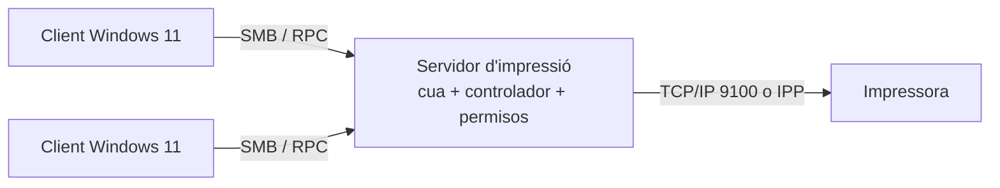
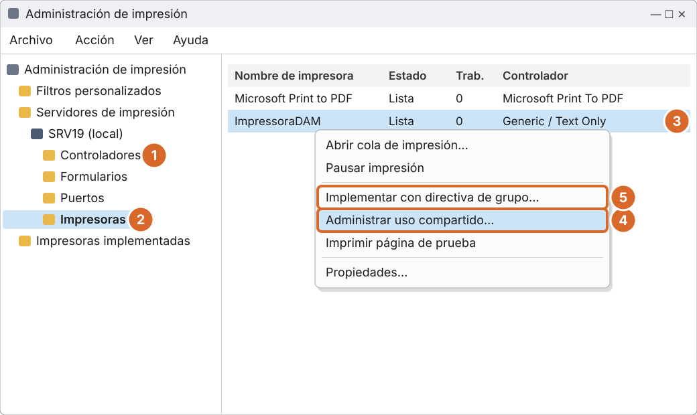
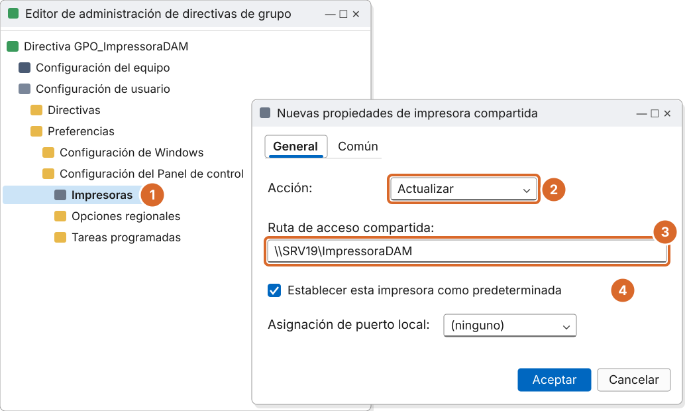

# Tema 6 · Servidor d'impressió i desplegament per GPO

> **Mòdul:** Administració de sistemes operatius · 2n DAM
> **Entorn de referència:** Windows Server 2025 (o 2019/2022) i clients Windows 11
> **Durada orientativa:** 1-2 sessions

## Objectius

- Instal·lar i configurar el rol de servidor d'impressió.
- Entendre la situació actual dels controladors d'impressora i la seguretat (PrintNightmare).
- Compartir una impressora i configurar-ne els permisos.
- Desplegar la impressora als usuaris amb una GPO.

---

## 1. Per què un servidor d'impressió

- **Un sol punt de control:** totes les cues, controladors i permisos es gestionen al servidor.
- **Els clients només connecten:** els usuaris accedeixen a `\\SRV19\Impressora` i reben el controlador del servidor.
- **Desplegament automàtic:** amb una GPO la impressora apareix sola als usuaris d'un grup o UO.



---

## 2. Les peces

| Peça | Què és |
|---|---|
| Rol **Servicios de impresión y documentos** | Rol de Windows Server que converteix l'equip en servidor d'impressió |
| **Administración de impresión** | Consola per gestionar impressores, controladors i ports (`printmanagement.msc`) |
| **Cola de impresión (Spooler)** | Servei que rep i gestiona els treballs. Ha d'estar en execució |
| **Port** | Com arriba el treball a la impressora: normalment un port TCP/IP |
| **Controlador (driver)** | Traductor entre Windows i el model concret d'impressora |

---

## 3. Els controladors avui

- **Controladors de classe:** Windows inclou un controlador IPP genèric que funciona amb les impressores certificades Mopria, sense instal·lar res.
- **Fi dels controladors de tercers a Windows Update:** des del 15 de gener de 2026 no s'hi publiquen controladors v3/v4 nous per a Windows 11 i Windows Server 2025. A partir de juliol de 2027 només hi haurà actualitzacions de seguretat dels existents.
- **Què vol dir per a nosaltres:** els fabricants els continuen oferint a la seva web, i els existents es poden continuar instal·lant. Per a la pràctica fem servir un controlador genèric.

---

## 4. PrintNightmare i Point and Print

El 2021 una vulnerabilitat de la cua d'impressió (**PrintNightmare**) permetia prendre el control d'equips. Des de llavors, per defecte, **només els administradors poden instal·lar controladors d'impressora** amb *Point and Print*.

**Conseqüència:** si el client no té el controlador, un usuari normal no podrà connectar la impressora. Per això instal·lem el controlador al servidor i, si cal, als clients.

Recomanacions:

- Desactivar el servei *Cola de impresión* als servidors que no imprimeixen, sobretot als **controladors de domini**.
- Windows 11 24H2 inclou el **Mode d'impressió protegida de Windows**, que només fa servir controladors de Microsoft.

```powershell
# Desactivar la cua d'impressió en un controlador de domini
Stop-Service Spooler
Set-Service Spooler -StartupType Disabled
```

---

## 5. Muntar el servidor pas a pas


### 5.1 Instal·lar el rol

*Administrador del servidor › Agregar roles y características › Servicios de impresión y documentos › Servidor de impresión*.

```powershell
Install-WindowsFeature Print-Services -IncludeManagementTools
```

### 5.2 Afegir el controlador

*Administración de impresión › Servidores de impresión › SRV19 › Controladores › botó dret › Agregar controlador › x64 › Windows Update* i tria **Generic › Generic / Text Only** o **Generic Mono XPS Class Driver**.

Sense Internet (en mode administrador):

```cmd
pnputil /add-driver C:\Windows\INF\prnms001.inf /install
```

### 5.3 Crear la impressora virtual i compartir-la

A l'aula fem servir una impressora virtual amb port TCP/IP a `127.0.0.1`:

1. *Impresoras › Agregar impresora › Agregar una impresora usando un puerto TCP/IP o nombre de host*.
2. Adreça: `127.0.0.1` (crea el port `IP_127.0.0.1`).
3. Controlador: **Generic / Text Only**.
4. Nom: **ImpressoraDAM**.
5. Propiedades › **Compartir** › *Compartir esta impresora* · nom `ImpressoraDAM`.



*Recreació esquemàtica de Windows Server 2025.*

1. **Controladores**: instal·lar el controlador genèric.
2. **Impresoras** › botó dret › Agregar impresora.
3. La impressora creada: **ImpressoraDAM**.
4. **Administrar uso compartido** per compartir-la.
5. **Implementar con directiva de grupo**: alternativa a les preferències (apartat 7).

> Si surt l'error «*Este tipo de impresora no se puede compartir*», crea-la amb port TCP/IP i un controlador genèric compatible.

---

## 6. Permisos d'impressora

| Permís | Què permet | Per defecte el té |
|---|---|---|
| **Imprimir** | Enviar treballs i gestionar els propis | Todos |
| **Administrar documentos** | Pausar, reiniciar o esborrar treballs de qualsevol usuari | CREATOR OWNER (els seus) |
| **Administrar esta impresora** | Canviar la configuració, compartir i permisos | Administradors |

Exemple de la pràctica: treure *Todos* i donar **Imprimir** només a `empresa\Professors`, i **Administrar documentos** al grup `Informàtica`.

---

## 7. Desplegar la impressora per GPO

### Opció A: preferències (recomanada)

1. A GPMC, botó dret a l'UO **Professors** › *Crear un GPO en este dominio y vincularlo aquí* › `GPO_ImpressoraDAM`.
2. Edita-la i ves a *Configuración de usuario › Preferencias › Configuración del Panel de control › Impresoras*.
3. Botó dret › Nuevo › **Impresora compartida**.



*Recreació esquemàtica de Windows Server 2025.*

1. *Impresoras* › botó dret › Nuevo › Impresora compartida.
2. Acción: **Actualizar**.
3. Ruta: `\\SRV19\ImpressoraDAM`.
4. Opcional: marcar-la com a predeterminada.

Amb *Común › Destinatarios de nivel de elemento* es pot mostrar només als membres d'un grup.

### Opció B: des de la consola d'impressió

*Administración de impresión ›* botó dret a la impressora › **Implementar con directiva de grupo** › tria la GPO i marca *usuarios* o *equipos*.

---

## 8. Comprovar-ho al client Windows 11

```cmd
:: Iniciar sessió com a empresa\pepito
gpupdate /force
gpresult /r
```

```powershell
Get-Printer                                           # impressores de l'usuari
Add-Printer -ConnectionName "\\SRV19\ImpressoraDAM"   # connectar-la a mà (prova)
```

A Windows 11: *Configuración › Bluetooth y dispositivos › Impresoras y escáneres*. Prova: botó dret › Propiedades de impresora › **Imprimir página de prueba**.

---

## 9. Resolució de problemes

| Problema | Què comprovar |
|---|---|
| No es veu a `\\SRV19` | `ping SRV19`, regla del tallafoc *Compartir archivos e impresoras* (perfil Dominio), servei Spooler en marxa (`services.msc`) |
| La GPO no s'aplica | `gpresult /r`, l'usuari és a l'UO correcta i membre del grup, filtrat de seguretat de la GPO |
| No s'instal·la el controlador | Controlador genèric al servidor; restricció Point and Print |
| Accés denegat | Pestanya *Seguridad* de la impressora: el grup té permís d'Imprimir |
| El nom no resol | Fer servir el nom DNS; la IP (`\\192.168.1.10\ImpressoraDAM`) només com a prova |

```powershell
Get-Service Spooler
Get-NetFirewallRule -DisplayGroup "Compartir archivos e impresoras" | Select-Object DisplayName, Enabled, Profile
Get-PrintJob -PrinterName ImpressoraDAM
```

---

## 10. Tot el servidor amb PowerShell

```powershell
Install-WindowsFeature Print-Services -IncludeManagementTools
Add-PrinterDriver -Name "Generic / Text Only"
Add-PrinterPort -Name "IP_127.0.0.1" -PrinterHostAddress "127.0.0.1"
Add-Printer -Name ImpressoraDAM -DriverName "Generic / Text Only" `
  -PortName "IP_127.0.0.1" -Shared -ShareName ImpressoraDAM
Get-Printer | Select-Object Name, Shared, ShareName, DriverName
Set-Printer -Name ImpressoraDAM -Comment "Aula DAM" -Location "Planta 2"
```

---

## 11. Alternativa al núvol: Universal Print

Microsoft 365 ofereix **Universal Print**: les impressores es registren al núvol i els equips units a Microsoft Entra ID hi imprimeixen sense servidor d'impressió local. Al mercat conviuen totes dues opcions; per entendre com funciona la impressió en un domini, el servidor clàssic continua sent la base.

---

## 12. Lliurament de la pràctica

- Captura d'*Administración de impresión* amb la impressora **ImpressoraDAM** creada i compartida.
- Captura de la pestanya *Seguridad* mostrant que **Professors** té permís d'impressió.
- Captura des del client Windows 11 mostrant **ImpressoraDAM** a *Impresoras y escáneres*.
- Explicació i argumentació del funcionament de la pràctica.

---

## 13. Comprova-ho

1. Quin servei de Windows ha d'estar en marxa perquè funcioni la impressió?
2. Per què un usuari normal no pot instal·lar el controlador d'una impressora compartida?
3. A quina part de la GPO afegim una impressora compartida per als usuaris?
4. Quin permís cal donar al grup Professors perquè hi pugui imprimir?

<details>
<summary>Respostes</summary>

1. La cola de impresión (*Print Spooler*).
2. Des de PrintNightmare (2021), per defecte només els administradors poden instal·lar controladors.
3. *Configuración de usuario › Preferencias › Configuración del Panel de control › Impresoras*.
4. Imprimir.

</details>

---

## Fonts

- [End of servicing plan for third-party printer drivers on Windows – Microsoft Learn](https://learn.microsoft.com/en-us/windows-hardware/drivers/print/end-of-servicing-plan-for-third-party-printer-drivers-on-windows)
- [Windows 11 v3/v4 printer drivers – Windows Latest](https://windowslatest.com/2026/02/09/no-windows-11-isnt-killing-millions-of-printers-but-its-ending-new-v3-v4-drivers-on-windows-update)
- [Mòdul PrintManagement de PowerShell – Microsoft Learn](https://learn.microsoft.com/en-us/powershell/module/printmanagement/)
