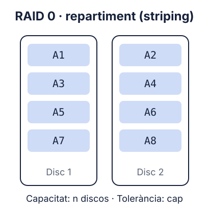
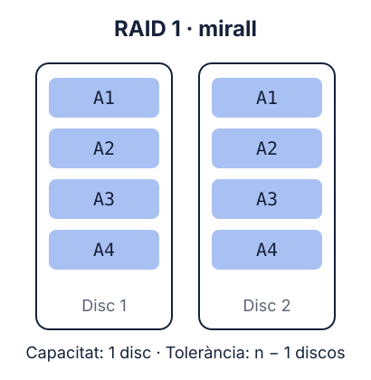
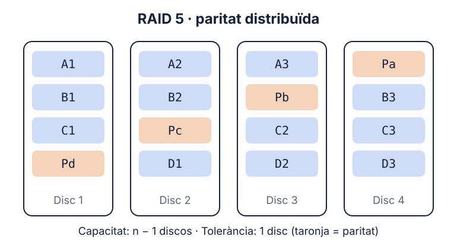
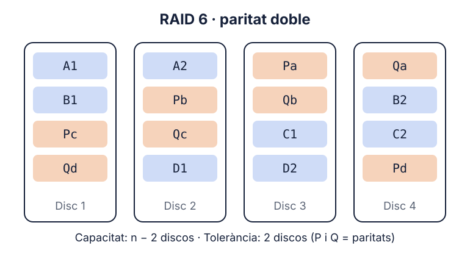
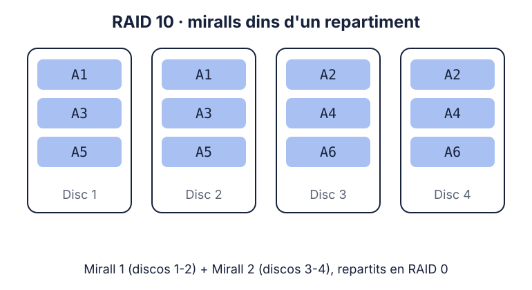
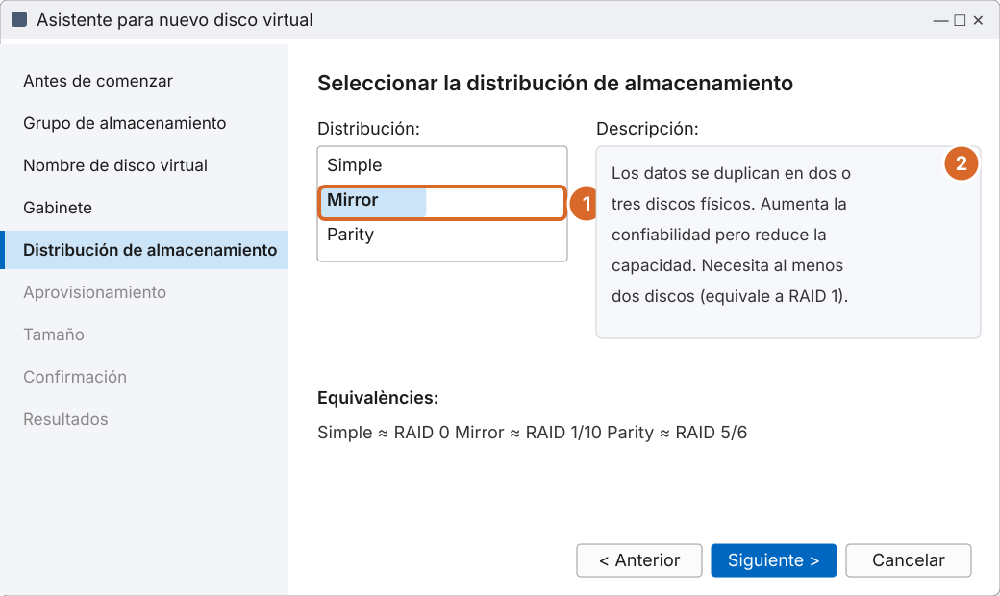

# Tema 7 · RAID i emmagatzematge en xarxa

> **Mòdul:** Administració de sistemes operatius · 2n DAM
> **Durada orientativa:** 1-2 sessions

## Objectius

- Entendre per què cal emmagatzematge redundant i què **no** fa un RAID.
- Conèixer els nivells RAID 0, 1, 5, 6 i 10 i calcular-ne la capacitat.
- Configurar RAID per programari a Windows (Espacios de almacenamiento) i a Linux (`mdadm`).
- Diferenciar NAS, SAN i emmagatzematge al núvol.

---

## 1. Un RAID no és una còpia de seguretat

> **Un RAID protegeix d'un disc espatllat. No protegeix de tu.**

Si esborres un fitxer, un ransomware el xifra o cau un llamp, el RAID copia el desastre a tots els discos. El RAID **no substitueix** les còpies de seguretat (vegeu la regla 3-2-1-1-0 al [tema 8](../08-alta-disponibilitat/README.md)).

Tot i que els discos són cada vegada més grans i fiables, continuen sent un dels punts dèbils dels sistemes. Els SSD i NVMe també fallen (per desgast de les cel·les o per errors del controlador).

---

## 2. Què és un RAID

RAID (*Redundant Array of Independent Disks*) combina diversos discos perquè el sistema els vegi com **una sola unitat lògica**, amb més rendiment, més tolerància a fallades o totes dues coses. La informació es divideix i/o es replica entre els discos.

| | RAID per maquinari | RAID per programari |
|---|---|---|
| Qui el gestiona | Una controladora RAID dedicada | El sistema operatiu |
| Avantatges | No carrega la CPU; sol permetre **canvi en calent** (*hot swap*) | No depèn d'una controladora concreta; flexible i barat |
| Inconvenients | La controladora és un nou punt de fallada; cal una de recanvi compatible | Fa servir una mica de CPU |
| Avui | Servidors amb controladores dedicades | Molt habitual: les CPU tenen potència de sobres (mdadm, ZFS, Espacios de almacenamiento) |

---

## 3. Nivells RAID

### RAID 0 · repartiment (*striping*)



Les dades es divideixen en blocs que es reparteixen alternativament entre els discos. Lectures i escriptures simultànies → màxima velocitat i capacitat. **Cap tolerància:** si falla un disc, es perd tot. Ús: dades no crítiques (edició de vídeo, temporals).

### RAID 1 · mirall (*mirroring*)



Tot es duplica a cada disc. Aguanta la fallada de tots els discos menys un, però només aprofites l'espai d'un disc. Ús: disc del sistema, petites empreses.

### RAID 5 · paritat distribuïda



Mínim **3 discos**. Les dades i la **paritat** es reparteixen entre tots els discos. Si en falla un, les dades es reconstrueixen a partir de la resta i la paritat. Perds l'espai d'un disc.

> **Paritat:** informació calculada (amb XOR) a partir de les dades que permet reconstruir-ne una part perduda. Exemple: si A = 1010 i B = 0110, P = A XOR B = 1100. Si es perd A, A = B XOR P = 1010.

### RAID 6 · paritat doble



Mínim **4 discos**. Dues paritats independents (P i Q): aguanta **2 fallades**. Perds l'espai de dos discos.

> **Per què RAID 6 avui:** amb discos de 20 TB o més, reconstruir un RAID 5 pot trigar dies. Si falla un segon disc durant la reconstrucció, es perd tot. Per això amb discos grans es prefereix RAID 6 o RAID 10.

### RAID 10 (1+0)



Parelles de discos en mirall (RAID 1) combinades en un repartiment (RAID 0). Mínim 4 discos; perds la meitat de l'espai. Escriptura ràpida i reconstrucció ràpida: ideal per a bases de dades i màquines virtuals.

> RAID 0+1 (repartiments en mirall) també existeix, però és pitjor: quan falla un disc, perd tota una meitat del conjunt.

---

## 4. Comparativa

| Nivell | Mínim discos | Capacitat útil (n discos) | Fallades que aguanta | Ús típic |
|---|---|---|---|---|
| RAID 0 | 2 | n | 0 | Edició de vídeo, dades temporals |
| RAID 1 | 2 | 1 disc | n − 1 | Disc del sistema, petites empreses |
| RAID 5 | 3 | n − 1 | 1 | Arxiu amb discos petits |
| RAID 6 | 4 | n − 2 | 2 | NAS amb discos grans |
| RAID 10 | 4 | n / 2 | 1 per mirall | Bases de dades, virtualització |

### Exercici: 4 discos de 4 TB

| RAID 0 | RAID 1 (4 en mirall) | RAID 5 | RAID 6 | RAID 10 |
|---|---|---|---|---|
| 16 TB | 4 TB (aguanta 3 fallades) | 12 TB | 8 TB | 8 TB |

---

## 5. RAID per programari a Windows: Espacios de almacenamiento

*Administrador del servidor › Servicios de archivos y almacenamiento › Volúmenes › Grupos de almacenamiento*:

1. Crear un **grupo de almacenamiento** amb els discos físics lliures.
2. Crear un **disco virtual** triant la distribució.
3. Crear un **volumen** sobre el disc virtual.



*Recreació esquemàtica de Windows Server 2025.*

1. Distribució **Mirror**: les dades es dupliquen.
2. La descripció indica quants discos calen.

| Distribució | Equivalent |
|---|---|
| Simple | ≈ RAID 0 |
| Mirror (2 o 3 còpies) | ≈ RAID 1 / RAID 10 |
| Parity (simple o doble) | ≈ RAID 5 / RAID 6 |

```powershell
# Discos que es poden afegir a un grup
Get-PhysicalDisk -CanPool $true

# Crear el grup, el disc virtual en mirall i el volum
New-StoragePool -FriendlyName "Grup1" -StorageSubSystemFriendlyName "Windows Storage*" `
  -PhysicalDisks (Get-PhysicalDisk -CanPool $true)
New-VirtualDisk -StoragePoolFriendlyName "Grup1" -FriendlyName "Mirall" `
  -ResiliencySettingName Mirror -UseMaximumSize
Get-VirtualDisk -FriendlyName "Mirall" | Get-Disk |
  Initialize-Disk -PassThru | New-Partition -AssignDriveLetter -UseMaximumSize |
  Format-Volume -FileSystem NTFS -NewFileSystemLabel "Dades"

# Estat de salut
Get-VirtualDisk | Select-Object FriendlyName, ResiliencySettingName, HealthStatus, OperationalStatus
```

Per a clústers de servidors existeix **Storage Spaces Direct** (S2D), que crea el grup amb els discos locals de diversos servidors.

---

## 6. RAID per programari a Linux: mdadm

```bash
# Instal·lar
sudo apt install mdadm

# Crear un RAID 1 amb dos discos
sudo mdadm --create /dev/md0 --level=1 --raid-devices=2 /dev/sdb /dev/sdc
# RAID 5 amb tres discos
sudo mdadm --create /dev/md1 --level=5 --raid-devices=3 /dev/sdd /dev/sde /dev/sdf

# Estat
cat /proc/mdstat
sudo mdadm --detail /dev/md0

# Formatar i muntar
sudo mkfs.ext4 /dev/md0
sudo mkdir /mnt/dades && sudo mount /dev/md0 /mnt/dades

# Desar la configuració perquè es munti en arrencar
sudo mdadm --detail --scan | sudo tee -a /etc/mdadm/mdadm.conf
sudo update-initramfs -u

# Simular una fallada i substituir el disc
sudo mdadm /dev/md0 --fail /dev/sdc
sudo mdadm /dev/md0 --remove /dev/sdc
sudo mdadm /dev/md0 --add /dev/sdg      # comença la reconstrucció
```

**ZFS** és un sistema de fitxers amb RAID integrat (RAID-Z1, Z2 i Z3, equivalents a paritat simple, doble i triple) i detecció de corrupció. És la base de TrueNAS i molt habitual a Proxmox.

```bash
sudo zpool create dades raidz1 /dev/sdb /dev/sdc /dev/sdd
zpool status
```

---

## 7. NAS i SAN

| | NAS | SAN |
|---|---|---|
| Què ofereix | Carpetes compartides (**nivell fitxer**) | Discos remots (**nivell bloc**) |
| Protocols | SMB, NFS | iSCSI, Fibre Channel, NVMe over Fabrics |
| El client ho veu com | Una unitat de xarxa | Un disc local |
| Rendiment | Bo; adequat per a la majoria d'empreses | Molt alt; adequat per a bases de dades i virtualització |
| Cost i complexitat | Baixos: des de casa fins a pimes | Alts: grans empreses i CPD |
| Exemples | Synology, QNAP, **TrueNAS** (abans FreeNAS), OpenMediaVault | Cabines de Dell, HPE, NetApp, Pure Storage |

> **Actualitzacions:** FreeNAS es diu ara TrueNAS. CIFS és un nom antic de SMB1; avui es parla de SMB. Els SSD i NVMe han reduït molt la diferència de velocitat.

Una SAN té connectivitat redundant: els servidors poden connectar-se a la cabina per més d'un camí (**multipath**), cosa que augmenta la tolerància a fallades.

### iSCSI amb Windows Server (laboratori)

Windows Server pot fer de destinació iSCSI (una mini-SAN):

```powershell
# Al servidor: rol i disc virtual iSCSI
Install-WindowsFeature FS-iSCSITarget-Server -IncludeManagementTools
New-IscsiVirtualDisk -Path "D:\iSCSI\disc1.vhdx" -SizeBytes 20GB
New-IscsiServerTarget -TargetName "Target1" -InitiatorIds "IQN:*"
Add-IscsiVirtualDiskTargetMapping -TargetName "Target1" -Path "D:\iSCSI\disc1.vhdx"

# Al client: connectar-s'hi (iniciador iSCSI)
Start-Service MSiSCSI
New-IscsiTargetPortal -TargetPortalAddress SRV19
Get-IscsiTarget | Connect-IscsiTarget
Get-Disk        # el disc remot apareix com si fos local
```

---

## 8. I l'emmagatzematge al núvol?

| Concepte | Descripció |
|---|---|
| **Emmagatzematge d'objectes** | Amazon S3, Azure Blob, Google Cloud Storage: capacitat pràcticament il·limitada i pagament per ús. Molt usat per a còpies de seguretat. |
| **Hiperconvergència** | Els mateixos servidors fan de còmput i d'emmagatzematge (Storage Spaces Direct, vSAN, Ceph a Proxmox). |
| **Híbrid** | Dades calentes al CPD local i dades fredes o còpies al núvol. |

---

## 9. Pràctica guiada

1. En una màquina virtual Windows Server, afegeix 3 discos virtuals de 10 GB.
2. Crea un grup d'emmagatzematge i un disc virtual **Mirror**. Comprova la capacitat útil.
3. Desconnecta un disc de la màquina virtual i comprova l'estat amb `Get-VirtualDisk`. Les dades continuen accessibles?
4. En una màquina virtual Linux, crea un RAID 5 amb `mdadm`, simula una fallada i reconstrueix-lo.
5. Calcula la capacitat de RAID 0, 1, 5, 6 i 10 amb 6 discos de 2 TB.

---

## 10. Comprova-ho

1. Si tens un RAID 1, encara necessites còpies de seguretat? Per què?
2. Quina capacitat útil té un RAID 5 amb 5 discos de 2 TB?
3. Per què amb discos molt grans es prefereix RAID 6 a RAID 5?
4. Quina diferència principal hi ha entre un NAS i una SAN?

<details>
<summary>Respostes</summary>

1. Sí: el RAID no protegeix d'esborrats, ransomware ni desastres.
2. 8 TB (n − 1 = 4 discos de 2 TB).
3. La reconstrucció és molt llarga i una segona fallada durant aquest temps faria perdre-ho tot.
4. El NAS comparteix fitxers (SMB/NFS); la SAN ofereix blocs, discos que el servidor veu com a locals.

</details>

---

## Fonts

- [Storage Spaces overview – Microsoft Learn](https://learn.microsoft.com/en-us/windows-server/storage/storage-spaces/overview)
- [mdadm – Linux Raid Wiki](https://raid.wiki.kernel.org/index.php/A_guide_to_mdadm)
- [iSCSI Target Server overview – Microsoft Learn](https://learn.microsoft.com/en-us/windows-server/storage/iscsi/iscsi-target-server)
