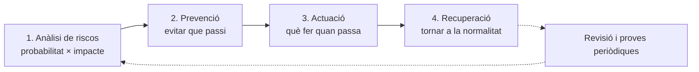

# Tema 8 · Alta disponibilitat i continuïtat del negoci

> **Mòdul:** Administració de sistemes operatius · 2n DAM
> **Durada orientativa:** 1-2 sessions

## Objectius

- Quantificar la disponibilitat i conèixer els conceptes RPO i RTO.
- Conèixer les solucions d'alta disponibilitat: CPD secundari, rèpliques de bases de dades, redundància de comunicacions, balanceig de càrrega i clústers.
- Aplicar la regla de còpies 3-2-1-1-0.
- Elaborar un pla de contingència.

---

## 1. Quant és «sempre disponible»?

La disponibilitat es mesura en «nous»:

| Disponibilitat | Temps aturat màxim a l'any | Temps aturat màxim al mes |
|---|---|---|
| 99 % | ≈ 3 dies 15 h | ≈ 7 h 18 min |
| 99,9 % | ≈ 8 h 46 min | ≈ 44 min |
| 99,99 % | ≈ 52 min | ≈ 4 min 23 s |
| 99,999 % | ≈ 5 min 15 s | ≈ 26 s |

Càlcul: temps aturat = (1 − disponibilitat) × 8.760 h. Cada «nou» extra multiplica el cost. La pregunta clau és **quant costa una hora aturada**.

```powershell
# Calcular el temps aturat permès
$disp = 0.9999
[TimeSpan]::FromHours((1 - $disp) * 8760)
```

---

## 2. RPO i RTO

| Concepte | Pregunta | Exemple |
|---|---|---|
| **RPO** (*Recovery Point Objective*) | Quantes dades puc perdre? | Si faig còpia cada nit, l'RPO és de fins a 24 h de dades perdudes. |
| **RTO** (*Recovery Time Objective*) | Quant temps puc estar aturat? | Temps màxim acceptable per tornar a donar servei. |


Sincronia o asincronia, CPD secundaris, rèpliques… tot es tria segons l'RPO i l'RTO que necessita el negoci.

---

## 3. CPD secundari

Un centre de processament de dades (CPD) secundari entra en funcionament quan el principal deixa d'estar operatiu. Ha de tenir característiques tècniques i mesures de seguretat (física i lògica) iguals o molt semblants al principal.

| | Replicació síncrona | Replicació asíncrona |
|---|---|---|
| Com funciona | Cada canvi es copia en temps real | Els canvis s'envien amb retard o per lots |
| Dades perdudes (RPO) | Pràcticament zero | Les dels últims minuts o hores |
| Cost | Molt alt: enllaços ràpids, distància limitada | Més baix |
| Canvi de CPD | Ràpid i automàtic | Més lent, sovint manual (cal restaurar dades) |

- **Ubicació:** prou lluny per no patir el mateix desastre (inundació, incendi, tall elèctric de zona). Com més lluny, més latència en la replicació.
- **Avui:** sovint el CPD secundari és el **núvol** (*DRaaS, Disaster Recovery as a Service*). Els proveïdors ofereixen **zones de disponibilitat**: CPD separats dins d'una mateixa regió.

---

## 4. Alta disponibilitat en bases de dades

Les bases de dades (sobretot les dels ERP) són un dels punts més crítics: reben moltes peticions i una caiguda pot suposar pèrdues econòmiques importants.

- **Bon disseny inicial:** escalable i amb aplicacions que fan només les peticions necessàries.
- **Primària i rèplica:** una base de dades de producció i una o més rèpliques en **servidors diferents**.
  - **Síncrona:** la transacció no s'acaba fins que s'ha escrit a les dues. Permet commutació automàtica sense pèrdua de dades, però les transaccions són una mica més lentes.
  - **Asíncrona:** més rendiment, però si cal canviar a la rèplica es poden perdre les últimes transaccions.

| Producte | Solució |
|---|---|
| SQL Server | Always On (grups de disponibilitat) |
| Oracle | Data Guard |
| PostgreSQL | Replicació en streaming (+ Patroni per a la commutació automàtica) |
| MySQL / MariaDB | Group Replication / Galera Cluster |
| Al núvol | Bases de dades gestionades amb rèplica a diverses zones (Amazon RDS Multi-AZ, Azure SQL) |

---

## 5. Redundància en les comunicacions

No serveix de res un servidor disponible al 100 % si els clients no s'hi poden connectar.

| Nivell | Solució |
|---|---|
| **Servidor** | Dues targetes de xarxa agrupades (**NIC Teaming** / **SET**, *Switch Embedded Teaming*): si en cau una, l'altra continua; i sumen ample de banda. |
| **Xarxa interna** | Commutadors redundants i enllaços en **anell**. **STP/RSTP** evita bucles: desactiva un enllaç i l'activa si cau un altre. |
| **Internet** | Dos proveïdors amb tecnologies diferents, per exemple fibra i 4G/5G. **SD-WAN** reparteix el trànsit entre les línies. |

> **Actualització:** els apunts antics proposaven fibra + ADSL. L'ADSL està pràcticament retirada; avui la segona línia sol ser 4G/5G o una altra fibra d'un altre operador.

```powershell
# Crear un equip de NIC a Windows Server
New-NetLbfoTeam -Name "Equip1" -TeamMembers "Ethernet1","Ethernet2" -TeamingMode SwitchIndependent
Get-NetLbfoTeam
# Amb Hyper-V es recomana SET:
New-VMSwitch -Name "vSwitchSET" -NetAdapterName "Ethernet1","Ethernet2" -EnableEmbeddedTeaming $true
```

```text
! Switch Cisco: activar Rapid Spanning Tree
spanning-tree mode rapid-pvst
show spanning-tree
```

---

## 6. Repartiment de càrrega

Un **balancejador** reparteix les peticions entre diversos servidors iguals. Si un cau, deixa d'enviar-li trànsit. No és alta disponibilitat en si mateix, però evita saturacions i permet seguir donant servei amb menys servidors.

- **Exemples:** HAProxy, NGINX, F5, balancejadors del núvol (Azure Load Balancer, AWS ELB).
- **A Windows:** Network Load Balancing (NLB) està obsolet a Windows Server 2025: es fan servir balancejadors externs.

Exemple mínim amb NGINX:

```nginx
upstream web {
    server 192.168.1.11;
    server 192.168.1.12;
}
server {
    listen 80;
    location / { proxy_pass http://web; }
}
```

---

## 7. Clústers

Un clúster és un conjunt de nodes interconnectats per una xarxa d'alta velocitat que actuen coordinadament com una sola unitat.

| | Alt rendiment (HPC) | Alta disponibilitat |
|---|---|---|
| Objectiu | Sumar capacitat de càlcul | Que el servei no s'aturi |
| Nodes | Molts, treballant en paral·lel en un mateix problema | Pocs (sovint 2), que es vigilen entre ells |
| Ús | Clima, genòmica, IA | Bases de dades, fitxers, aplicacions crítiques |

> **MareNostrum 5** (Barcelona Supercomputing Center): inaugurat el desembre de 2023, té un rendiment màxim de 314 petaflops, 23 vegades més que el MareNostrum 4. Ocupa una sala nova al costat de la capella de Torre Girona, on hi havia les versions anteriors.

### Clúster d'alta disponibilitat

| | Actiu-actiu | Actiu-passiu |
|---|---|---|
| Funcionament | Tots els nodes donen servei alhora | Un node treballa, l'altre espera |
| Si cau un node | Els altres absorbeixen la càrrega | El passiu pren el relleu (*failover*) |
| Aprofitament | Alt | Baix: un node està parat |
| Complexitat | Alta | Més senzilla |

També serveixen per fer **manteniment** sense aturar el servei: es mouen els serveis a un node, s'actualitza l'altre i al revés.

**Eines:** Clúster de conmutación por error (Windows), Pacemaker + Corosync (Linux), Kubernetes per a contenidors.

```powershell
# Windows: clúster de commutació per error
Install-WindowsFeature Failover-Clustering -IncludeManagementTools
Test-Cluster -Node SRV1, SRV2
New-Cluster -Name CLUSTER1 -Node SRV1, SRV2 -StaticAddress 192.168.1.50
Get-ClusterNode
Move-ClusterGroup -Name "Servei" -Node SRV2     # moure un servei manualment
```

---

## 8. La virtualització ho facilita

- **Migració en viu:** moure una màquina virtual d'un servidor físic a un altre sense aturar-la, per fer manteniment.
- **Reinici automàtic:** si un host cau, el clúster arrenca les seves màquines virtuals en un altre host.
- **Plataformes:** Hyper-V, VMware vSphere i Proxmox VE. Al núvol, la plataforma ho gestiona per tu.

```bash
# Proxmox VE: posar una màquina virtual en alta disponibilitat
ha-manager add vm:100
ha-manager status
qm migrate 100 node2 --online
```

---

## 9. Còpies de seguretat: la regla 3-2-1-1-0

| | |
|---|---|
| **3** | còpies de les dades (l'original + 2) |
| **2** | suports diferents (disc, cinta, núvol…) |
| **1** | còpia fora de l'empresa |
| **1** | còpia **immutable** o **desconnectada** (*air gap*) |
| **0** | errors en la prova de restauració |

La còpia immutable o desconnectada és la defensa contra el **ransomware**, que intenta xifrar també les còpies.

```powershell
# Windows Server Backup
Install-WindowsFeature Windows-Server-Backup
wbadmin start backup -backupTarget:E: -include:D:\Dades -quiet
wbadmin get versions
```

```bash
# Linux: còpia incremental amb rsync
rsync -av --delete /srv/dades/ /mnt/copia/dades/
```

---

## 10. Pla de contingència

Siguin quines siguin les mesures, sempre es poden produir fallades no previstes. Llavors entra en joc el **pla de contingència**: el conjunt de procediments alternatius que permeten a l'empresa continuar treballant quan alguna funció es veu afectada per un incident intern o extern.



### Anàlisi de riscos

Per a cada amenaça es valora la **probabilitat** i l'**impacte**, i es comença pels riscos més alts.

| Amenaça | Probabilitat | Impacte | Prioritat |
|---|---|---|---|
| Ransomware | Alta | Molt alt | 1 |
| Fallada d'un disc | Alta | Mitjà (amb RAID) | 2 |
| Caiguda de la línia d'Internet | Mitjana | Alt | 3 |
| Incendi al CPD | Baixa | Molt alt | 4 |

### Tipus de solucions

- **Preventives:** accions per evitar que l'amenaça es materialitzi.
- **D'actuació:** què fer quan passa, per reduir-ne l'impacte. Sempre n'hi ha per a tots els riscos identificats.
- **De recuperació:** com tornar al funcionament normal.

Cada procediment d'actuació ha d'indicar: accions, metodologia i protocol, materials necessaris, persones implicades i les seves funcions, i la persona responsable.

El pla s'ha de **provar i revisar periòdicament**, i cada vegada que s'activa se n'ha de fer una valoració posterior. Un pla que no s'ha provat mai no és un pla.

### Pla de recuperació de desastres (DRP)

El **DRP** (*Disaster Recovery Plan*) és la part del pla de contingència centrada en els sistemes informàtics: protegeix contra incendis, inundacions, actes vandàlics, talls elèctrics, aturades del sistema i baixes de personal, entre d'altres.

---

## 11. Ja no és opcional: normativa

| Norma | Què exigeix |
|---|---|
| **Directiva NIS2** | Obliga les entitats essencials i importants de la UE a tenir gestió de còpies de seguretat, recuperació de desastres i continuïtat del negoci. |
| **ENS** (Esquema Nacional de Seguretat) | Exigeix mesures de continuïtat a l'administració pública i als seus proveïdors. |

---

## 12. Pràctica

Elabora el pla de contingència d'una empresa fictícia de 30 treballadors amb un servidor de fitxers, un ERP i una botiga en línia:

1. Defineix l'RPO i l'RTO de cada servei i justifica'ls.
2. Fes la taula d'anàlisi de riscos (mínim 6 amenaces).
3. Proposa les solucions d'alta disponibilitat (RAID, rèpliques, NIC Teaming, segona línia…) amb un pressupost aproximat.
4. Dissenya l'estratègia de còpies seguint la regla 3-2-1-1-0.
5. Escriu el procediment d'actuació complet per a l'amenaça de ransomware.

---

## 13. Comprova-ho

1. Què vol dir que un servei tingui una disponibilitat del 99,99 %?
2. Diferència entre RPO i RTO?
3. Quan triaries un clúster actiu-passiu en lloc d'un actiu-actiu?
4. Per què la regla 3-2-1-1-0 demana una còpia immutable o desconnectada?

<details>
<summary>Respostes</summary>

1. Que pot estar aturat uns 52 minuts a l'any com a màxim.
2. RPO: quantes dades puc perdre. RTO: quant temps puc estar sense servei.
3. Quan es prioritza la simplicitat i n'hi ha prou amb un node treballant.
4. Perquè el ransomware no la pugui xifrar ni esborrar.

</details>

---

## Fonts

- [MareNostrum 5 – Nació Digital](https://naciodigital.cat/societat/barcelona-estrena-el-marenostrum-5-un-dels-tres-unics-superordinadors-deuropa.html)
- [Failover Clustering overview – Microsoft Learn](https://learn.microsoft.com/en-us/windows-server/failover-clustering/failover-clustering-overview)
- [Features removed or no longer developed in Windows Server – Microsoft Learn](https://learn.microsoft.com/en-us/windows-server/get-started/removed-deprecated-features-windows-server)
- [Directiva (UE) 2022/2555 (NIS2) – EUR-Lex](https://eur-lex.europa.eu/eli/dir/2022/2555/oj)
